# Apple II Unicode Bridge (`apple2-unicode-bridge`)

[](https://github.com/mildstorm/apple2-unicode-bridge)
[](LICENSE)
[](#)
[](#)

> **Universal TrueType / Unicode Multilingual Font Bridge & I/O Engine for Apple II**  
> Stream high-resolution global typography (Hangul, Hanja, Kanji, Chinese, Cyrillic, Greek, Latin diacritics, and symbols) to Apple II High-Resolution Graphics (HGR 280×192) via Super Serial Card (SSC) without any ROM or hardware modifications.

[English](README.md) | [한국어 문서](README_HANGUL.md)

---

## 🌟 Overview

The original Apple II hardware is constrained by its 1970s character generator ROM, which only natively displays standard 7-bit US-ASCII uppercase/lowercase glyphs on a 40-column text screen. Supporting non-Latin writing systems historically required dedicated regional clone hardware (e.g., Korean TriGem/Sekyoung, Japanese J-Plus, Cyrillic Pravets-8D) or expensive custom character-generator expansion cards.

**`apple2-unicode-bridge`** solves this fundamentally by transforming the Apple II into a **universal multilingual platform** through modern PC font co-processing:

1. **Zero Hardware/ROM Modifications**: Uses the standard **Super Serial Card (SSC)** in Slot 2 (TCP socket for emulators, RS-232/USB-serial for real hardware).
2. **Global Unicode Coverage**: Dynamically rasterizes any Unicode script—Korean Hangul (all 11,172 syllables), CJK Hanja/Kanji/Chinese characters, Cyrillic, Greek, Arabic, accented Latin, and custom symbols—using TrueType / OpenType fonts via FreeType.
3. **Applesoft BASIC `&` (Ampersand) Integration**: Easily embed and execute multilingual strings directly in standard Applesoft BASIC programs using syntax like `10 & "\KHello World / 한글 / 漢字 / Привет / こんにちは\N"`.
4. **Hex-Safe Encoding Pipeline**: Prevents BASIC token collisions ($80–$EA) and `?SYNTAX ERROR` issues caused by Apple II 8-bit parsing conventions and Caps Lock states.
5. **Interactive Full-Screen Terminal**: Provides a real-time 280×192 graphic console with interactive keyboard input, IME support, and automatic word wrapping.
6. **Typing on the Apple II Keyboard**: `Ctrl+K` while writing BASIC opens an input line for 2-Bul-Sik Hangul with Hanja conversion, composed the way the Windows IMEs do, on the Apple II itself from the ProDOS hard disk (no PC needed), or by the PC server over the SSC, which also does Japanese kana, Russian and Greek (see [Ctrl+K](#2-interactive-ctrlk-input-2-bul-sik-hanja-kana-russian-greek)).
7. **Hard Disk Font for Real Hardware**: On a ProDOS hard disk the driver reads every glyph (Hangul, Hanja, kana, Greek, Cyrillic, symbols) from a font file, so a real Apple II shows Unicode with no PC connected (see [ProDOS Hard Disk](#-prodos-hard-disk-the-whole-font-no-server)).

---

## 🏗️ Architecture

```
+-------------------------------------------------------------+
|                       PC / Host System                      |
|                                                             |
|   +----------------------+       +----------------------+   |
|   |  FreeType / Pillow   | ----> |  unicode_server.py   |   |
|   |  TrueType Font (TTF) |       |  (TCP / COM Port)    |   |
|   +----------------------+       +----------------------+   |
+----------------------------------------------|--------------+
                                               |  Serial / TCP (Slot 2 SSC)
                                               v  9600-115200 Baud
+-------------------------------------------------------------+
|               Apple II (AppleWin or Real Hardware)          |
|                                                             |
|   +-------------------+         +-----------------------+   |
|   | 6551 ACIA (Slot 2)| ------> | UNICODE.BIN Driver    |   |
|   +-------------------+         | (Resident at $4000)   |   |
|                                 +-----------------------+   |
|                                             |               |
|                                             v               |
|                           +-------------------------------+ |
|                           | HGR Page 1 ($2000-$3FFF)      | |
|                           | 280 x 192 Multilingual Screen | |
|                           +-------------------------------+ |
+-------------------------------------------------------------+
```

### Font Metrics & Layout on HGR Screen
- **Full-width characters (CJK, etc.)**: 14×16 pixels (20 columns × 12 rows).
- **Half-width characters (ASCII, Latin, etc.)**: 7×16 pixels (40 columns × 12 rows).
- Pixel-perfect rasterization ensures clean readability on composite color and monochrome monitors alike without artifact distortion.

---

## 📺 Live Demonstration: 祭亡妹歌 (Je-mang-mae-ga) with Mixed Hanja & Hangul

Below is an authentic Apple II High-Resolution (HGR 280×192) display of the famous 8th-century Korean Hyangga poem *Je-mang-mae-ga* (Master Wolmyeong), demonstrating **mixed Classical Chinese Hanja (漢字) and Korean Hangul (한글)** rendered dynamically without modifying any Apple II ROM:

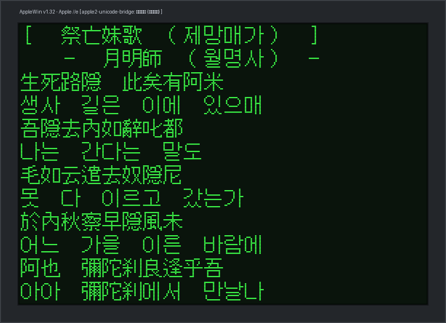

### The Applesoft BASIC Program

You can write this directly in Applesoft BASIC using standard line numbers and the `&` ampersand extension:

```basic
10 REM ====================================================
20 REM  祭亡妹歌 (제망매가) - 月明師 (월명사)
30 REM  Multilingual Hanja & Hangul Demo on Apple II HGR
40 REM ====================================================
50 & "\K[ 祭亡妹歌 (제망매가) ]\N"
60 & "\K  - 月明師 (월명사) -\N"
70 & "\K生死路隱 此矣有阿米\N"
80 & "\K생사 길은 이에 있으매\N"
90 & "\K吾隱去內如辭叱都\N"
100 & "\K나는 간다는 말도\N"
110 & "\K毛如云遣去奴隱尼\N"
120 & "\K못 다 이르고 갔는가\N"
130 & "\K於內秋察早隱風未\N"
140 & "\K어느 가을 이른 바람에\N"
150 & "\K阿也 彌陀刹良逢乎吾\N"
160 & "\K아아 彌陀刹에서 만날나\N"
```

### How to Input Hanja & Multilingual Text in AppleWin:
1. Type `50 & "` in AppleWin.
2. Press **`Ctrl+K`**, then **`Ctrl+P`** to type the line on the PC. (Or type it on the Apple II keyboard: Hangul in 2-Bul-Sik, each syllable turned into Hanja with `Ctrl+J`; see [Ctrl+K](#2-interactive-ctrlk-input-2-bul-sik-hanja-kana-russian-greek).)
3. A host input prompt appears on your PC (a window with `--popup`). Type or paste `[ 祭亡妹歌 (제망매가) ]` and press `Enter`, then `Return` on the Apple II.
4. The bridge automatically injects the hex-safe stream `\K[ 祭亡妹歌 (제망매가) ]\N` into the BASIC prompt.
5. Close the quotes with `"` and press `Enter`.
6. Type `RUN` — the Apple II immediately switches to HGR High-Resolution graphics and draws the rendered typography!

---

## 📜 Live Demonstration: 訓民正音 (Hunminjeongeum) in Old Hangul

The preface of *Hunminjeongeum* (1446) is written in old Hangul: arae-a (ㆍ), obsolete jamo such as ᄊ ᄍ ᄠ ᇰ ᇙ, and syllables with no precomposed codepoint. The server composes each syllable from its conjoining jamo with HarfBuzz and draws it in one 14×16 cell, so nothing is spelled apart (see [Old Hangul](#5-old-hangul-hunminjeongeum-composed-a-syllable-to-a-cell)).

Captured from the LCD of an emulated Apple //e (STM32F769I-DISCO board, monochrome monitor), with the server streaming over the Super Serial Card:

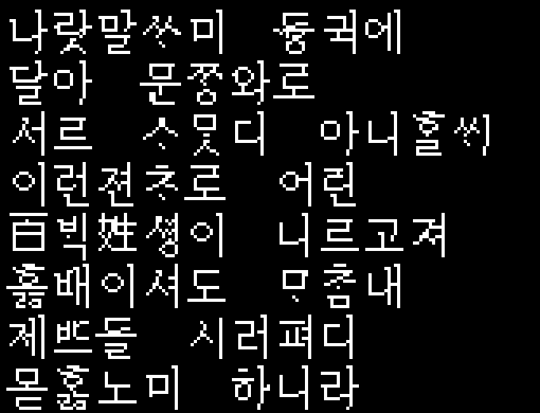

```basic
10 & "\KEB8298EB9E8FEBA790E1848AE1869EEBAFB820EB9380E187B0EAB781EC9790\N"
20 & "\KEB8BACEC958420EBACB8E1848DE1869EE186BCEC9980EBA19C\N"
30 & "\KEC849CEBA5B420E18489E1869EE18486E1869EE186BAEB949420EC9584EB8B88E18492E1869EE186AFE1848AE186A1\N"
40 & "\KEC9DB4EB9FB0ECA0BCE1848EE1869EEBA19C20EC96B4EBA6B0\N"
50 & "\KE799BEE18487E186A1E186A8E5A793EC8594E187B0EC9DB420EB8B88EBA5B4EAB3A0ECA0B8\N"
60 & "\KED98B8E18799EBB0B0EC9DB4EC8594EB8F8420E18486E1869EE1848EE1869EE186B7EB82B4\N"
70 & "\KECA09CE184A0E185B3EB93A420EC8B9CEB9FACED8EB4EB9494\N"
80 & "\KEBAAAFE18492E1869EE18799EB85B8EBAFB820ED9598EB8B88EB9DBC\N"
```

The hex strings are UTF-8 for:

```
나랏말ᄊᆞ미 듀ᇰ귁에 / 달아 문ᄍᆞᆼ와로 / 서르 ᄉᆞᄆᆞᆺ디 아니ᄒᆞᆯᄊᆡ / 이런젼ᄎᆞ로 어린
百ᄇᆡᆨ姓셔ᇰ이 니르고져 / 호ᇙ배이셔도 ᄆᆞᄎᆞᆷ내 / 제ᄠᅳ들 시러펴디 / 몯ᄒᆞᇙ노미 하니라
```

Paste the text with **`Ctrl+K`** then **`Ctrl+P`** instead of typing hex, as for any other Unicode string. Composition needs `pip install uharfbuzz`.

### How to Run It (AppleWin)

1. Install the Python packages, `uharfbuzz` included:
   ```bash
   pip install pillow freetype-py uharfbuzz
   ```
2. In AppleWin, open **Configuration** and set **Serial Port** to **TCP**: the Super Serial Card in slot 2 then listens on TCP port 1977. For the cleanest strokes set **Video** to a **Monochrome** mode (a colour mode fringes one-pixel strokes).
3. Insert [`unicode.dsk`](unicode.dsk) in drive 1 and boot it. `HELLO` loads the driver at `$4000` and the font cache at `$6000`, and leaves you at the `]` prompt.
4. Start the PC server; it connects to AppleWin's port 1977 (on real hardware, `--com COMx` instead):
   ```bash
   python unicode_server.py
   ```
5. At the `]` prompt, switch off the disk's font cache, so that every `&` string goes to the server:
   ```basic
   POKE 24576,0
   ```
   *Without this step the driver draws from the `$6000` cache that `HELLO` loaded, which holds glyphs one UTF-8 character at a time: old Hangul there is spelled apart, jamo by jamo.*
6. Type the program above (or paste each line's text with `Ctrl+K`, `Ctrl+P` after `10 & "`), then `RUN`.

The same program in AppleWin 1.32.1 (Monochrome Green), captured from its window:

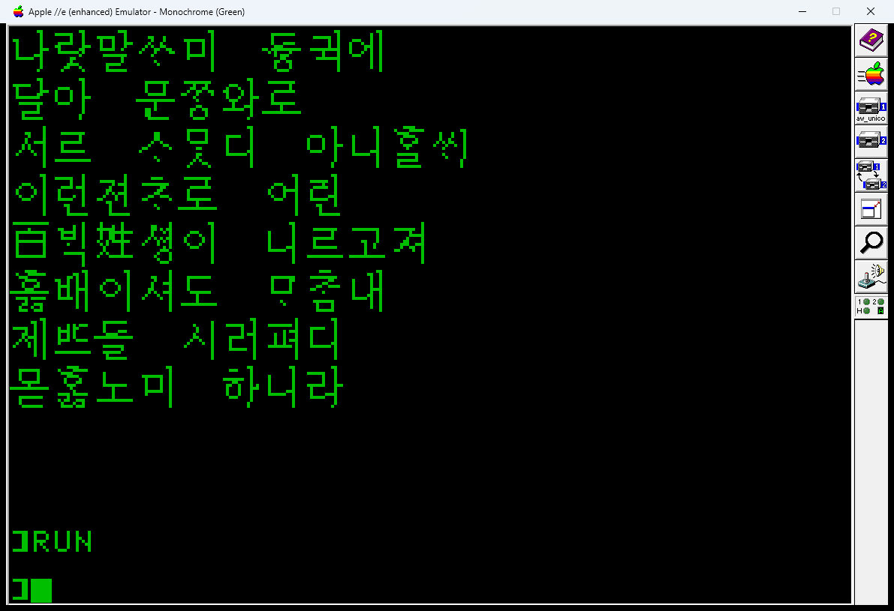

---

## 🚀 Key Features

### 1. Applesoft BASIC Extension (`&`)
You can print multilingual Unicode text right from Applesoft BASIC:

```basic
10 & "\KWelcome to Apple II Unicode Bridge!\N"
20 & "\K한글과 漢字 및 다국어 폰트 출력\N"
30 & "\KHello, こんにちは, Привет, Bonjour!\N"
```
When executed (`RUN`), the driver switches to HGR graphics mode and renders high-density typographic glyphs with accurate letter spacing and vertical alignment.

### 2. Interactive `Ctrl+K` Input (2-Bul-Sik, Hanja, Kana, Russian, Greek)

> [!IMPORTANT]
> **Two ways to compose: on the Apple II (default) or on the PC through the Super Serial Card**
>
> | | **Onboard** (default) | **SSC** (`POKE 16453,1`) |
> | :--- | :--- | :--- |
> | Where it composes | The 6502 driver itself | The PC server (`unicode_server.py`) |
> | Needs | The ProDOS hard disk (`unicode.hdv`, its `UFONT`) | A Super Serial Card in slot 2 and the server |
> | Modes | 한 2-Bul-Sik with Hanja (`Ctrl+J`), A | 한, あ, ア, Я, Ω, A, `Ctrl+P` (PC input), terminal mode |
>
> - Under ProDOS with `UFONT`, `Ctrl+K` composes **on the Apple II with no serial card or PC**: the driver holds the 2-Bul-Sik automaton (the same rules as the server's, checked against the same cases by `tools/test_onboard_ime.py`), draws the line from `UFONT`, and reads the Hanja candidates from it.
> - `POKE 16453,1` hands `Ctrl+K` to the PC server over the SSC (kana, Russian, Greek, `Ctrl+P`), `POKE 16453,0` brings it back. Without `UFONT` (the DOS 3.3 floppy `unicode.dsk`) it is always the server.
> - **SSC setup**: **AppleWin**: **Configuration (F10) → [Serial] tab**, **Slot 2 Serial Port** set to **`TCP`** (port 1977). **Real Apple II**: a **Super Serial Card** in **Slot 2**, an RS-232 / USB-serial cable to the PC, and `python unicode_server.py --com COMx`.

While typing a BASIC program, press **`Ctrl+K`** and type on the Apple II keyboard. An input line opens on the last HGR row in mixed mode, with the four text lines (and so the BASIC line, once it is near the bottom) below it. As in the Windows IMEs, what is being composed is shown inverse and commits once the next key cannot join it.

| Mode (col 0) | Typing | Example |
| :--- | :--- | :--- |
| **한** 2-Bul-Sik | Standard layout; Shift for ㄲ ㄸ ㅃ ㅆ ㅉ ㅒ ㅖ (repeating a key does not double it). Backspace takes back one jamo (과 → 고, 닭 → 달). | `dkssud` → 안녕, `ekfrk` → 달가, `rt` → ㄳ |
| **あ** / **ア** Kana | Romaji to hiragana / katakana as the Microsoft IME takes it: `kka` → っか, `n` before a consonant or `nn` → ん, `-` → ー, `,` `.` → 、。, `[` `]` → 「」 | `nihon` → にほん, `ko-hi-` → コーヒー |
| **Я** Russian | ЙЦУКЕН layout (`/` and `?` type `.` and `,`) | `ghbdtn` → привет |
| **Ω** Greek | Greek layout; `;` then a vowel adds the tonos, `:` the dialytika | `kalhm;era` → καλημέρα |
| **A** | As typed | |

| Key | Action |
| :--- | :--- |
| `Ctrl+K` | Language ↔ A (the 한/영 key) |
| `Ctrl+L` | Next language: 한 → あ → ア → Я → Ω (`--ime-langs ko,hira,kata,ru,el` picks and orders them; the first is the default). SSC mode only |
| `Ctrl+J` (↓) | **Hanja** for the syllable being composed, or the one before the cursor. The candidates (8,649 Hanja for 486 readings, most common first) appear on the row above: `1`–`9` picks, `Space` / → / ↓ next page, ← / ↑ previous, `Return` the first, `Esc` closes the list |
| `Ctrl+P` | PC input (console, or a window with `--popup`): anything else, typed with the PC's own IME or pasted, is added to the line. SSC mode only |
| `Return` | Puts the line into BASIC as hex-safe `\K…\N` |
| `Esc` | Cancels |

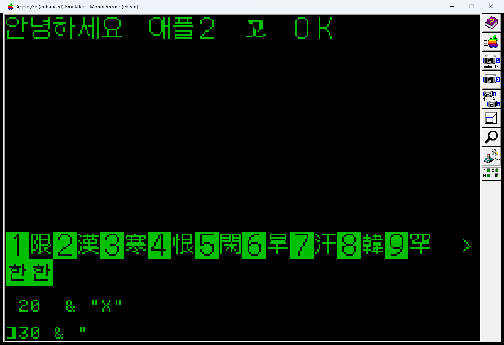

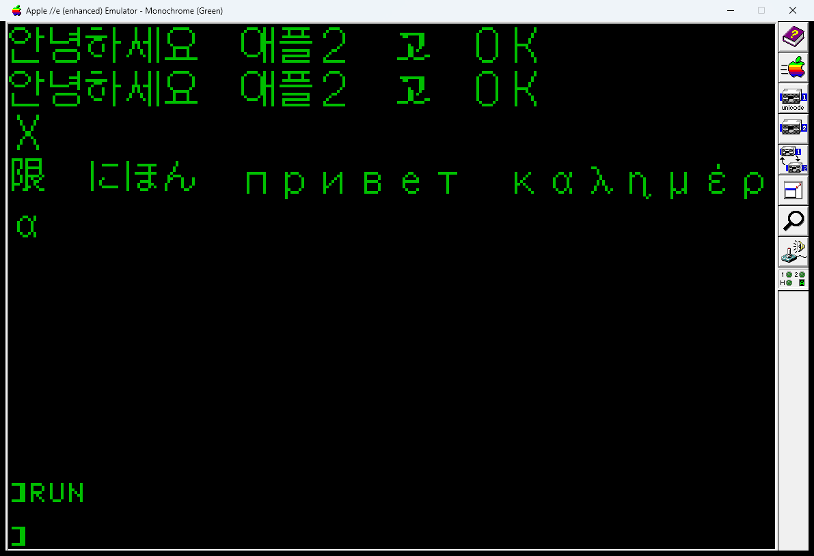

**Shift and Caps Lock**: with AppleWin on the same PC the server reads the PC's Shift key, so Caps Lock does not matter. On real hardware (or an emulator on another machine) only the letter's case arrives, and a //e starts with Caps Lock on, sending every letter in upper case. For 2-Bul-Sik the server tells the two apart: an upper-case letter that Shift does nothing for (any but Q W E R T O P) means Caps Lock is on, and from then on letters count as unshifted; the syllable being typed is read again that way (R K, first read as 까, becomes 가 at the K). A lower-case letter means Caps Lock is off, and Shift counts again (Shift+R = ㄲ). So 2-Bul-Sik works with Caps Lock either way; ㄲ ㄸ ㅃ ㅆ ㅉ ㅒ ㅖ need it off. Russian and Greek letters come in the case typed, as on a PC with Caps Lock. On a II+, with no lower case, the Shift-only letters cannot be typed.

Hanja are converted a syllable at a time, and kana stay kana (there is no kana-to-kanji conversion; use `Ctrl+P` for kanji). The Hanja table `hanja_table.txt` is built from the Unicode Han Database by `tools/build_hanja_table.py`.

The onboard line guesses Caps Lock the same way from the letter's case (it never sees Shift either).

`python unicode_server.py --pc-input` makes SSC mode open the PC input straight away. Tests: `python tools/test_dubeol_ime.py` (2-Bul-Sik rules), `python tools/test_onboard_ime.py` (the driver's 6502 automaton on the same cases, in py65), `python tools/test_ime_engines.py` (kana, Russian, Greek, Hanja, mode keys) and `python tools/test_ime_live.py` (types lines in AppleWin and saves screenshots).

### 3. Hex-Safe Stream Protocol (`\K ... \N`)
Standard Apple II line input (`GETLN`) and Applesoft keyword parsing (`PARSE`) treat byte values `$80`–`$FF` as internal BASIC tokens or control codes. Raw UTF-8 byte streams cause immediate syntax errors.
- **`apple2-unicode-bridge`** encapsulates Unicode streams inside a robust hex/escape framing protocol (`\K<HEX>\N`).
- It remains completely unaffected by the Apple II `Caps Lock` state, quote delimiters, or carriage return filters.

### 4. Interactive Terminal Mode
Entering `&` on its own at the Applesoft prompt `]` drops into a full-screen graphics terminal, drawn by the server (DOS 3.3 or ProDOS):
- 2-Bul-Sik Hangul composed as on the `Ctrl+K` line, Latin characters, and hotkeys.
- Toggle between Hangul and English with `Ctrl+K` or `` ` `` (backtick).
- `ESC` returns to Applesoft BASIC; the server keeps running and goes back to BASIC mode.

### 5. Old Hangul (Hunminjeongeum) Composed a Syllable to a Cell
Old Hangul (arae-a ㆍ, obsolete jamo, bangjeom tone marks) has no precomposed codepoints: a syllable is a run of conjoining jamo (U+1100–11FF, U+A960–A97F, U+D7B0–D7FF). Drawn a codepoint at a time it comes out spelled apart. The server shapes each syllable with HarfBuzz using `NotoSerifCJK16.ttf`'s `ljmo/vjmo/tjmo` features and draws it into one 14×16 cell (`old_hangul.py`); a string containing old Hangul draws its modern syllables in the same typeface. Example: `10 & "\KEB8298EB9E8FEBA790E1848AE1869EEBAFB8\N"` shows `나랏말ᄊᆞ미` in five cells.
- Needs `pip install uharfbuzz`; without it (or without the font) the server says so at start-up and draws jamo by jamo as before.
- Live server streaming only: the standalone `$6000` `FONT` cache keys glyphs by one 3-byte UTF-8 character, so old Hangul there is still drawn jamo by jamo. After booting `unicode.dsk`, run `POKE 24576,0` first so the strings go to the server (see [How to Run It](#how-to-run-it-applewin)).

The Hunminjeongeum preface streamed over the SSC to an emulated Apple //e (an STM32F769I-DISCO board's LCD, monochrome monitor), every syllable in one cell:

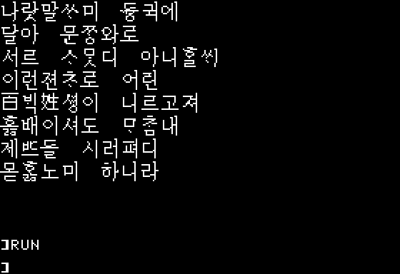

### 6. Standalone Execution via Font Subsetting (No PC Server Required!)
While the live font server streams unlimited Unicode glyphs dynamically, you can also bake the exact subset of fonts used by your BASIC programs directly into the `.dsk` disk image:
- **Zero PC dependency**: Once baked, the Apple II boots and runs multilingual graphics programs entirely standalone from floppy disk.
- **Microscopic footprint**: Extracting all 77 unique Hanja and Hangul characters for the *Je-mang-mae-ga* and `DEMO` suites consumes **only 2.7 KB** of disk space (as binary `FONT` loaded at `$6000`).
- **One-click baking tool**: Run `python build_font_dsk.py --dsk unicode.dsk` to scan all BASIC programs, rasterize their characters, inject the `FONT` binary, and patch `HELLO` automatically.

---

## 📦 Repository Structure

| File | Description |
| :--- | :--- |
| **`unicode_server.py`** | Universal Unicode font co-processor & streaming serial/TCP server (Python 3). |
| **`old_hangul.py`** | Old Hangul (Hunminjeongeum) syllable composition with HarfBuzz, used by the server. |
| **`apple_ime.py`** | `Ctrl+K` input engines besides 2-Bul-Sik (kana, Russian, Greek) and the Hanja lookup. |
| **`hanja_table.txt`** | Hangul reading → Hanja candidates, built from Unihan by `tools/build_hanja_table.py`. |
| **`build_hdd.py`** | Builds a bootable ProDOS hard-disk image with the whole font (`UFONT`) for drawing without the server. |
| **`tools/prodos_image.py`** | ProDOS volume reader/writer (sparse files, up to 32 MB) and Applesoft tokenizer, used by `build_hdd.py`. |
| **`unicode_server.exe`** | Standalone pre-compiled Windows executable (bundled with default CJK font). |
| **`ac_tool.py`** | AppleCommander management wrapper & standalone DSK inspection CLI. |
| **`build_font_dsk.py`** | Automated font subsetter: extracts used glyphs, bakes `FONT` binary ($6000) into DSK for standalone execution. |
| **`inject_basic.py`** | PC-to-Apple II BASIC injector tool with automatic font synchronization. |
| **`verify_dsk_font.py`** | Verification utility confirming glyph rendering directly from DSK `FONT` binary. |
| **`unicode_driver.s`** | 6502 assembly source code for the Apple II resident driver ($4000). |
| **`unicode.dsk`** | Ready-to-boot DOS 3.3 disk image containing `UNICODE.BIN`, standalone `FONT`, and demo programs. |
| **`unicode.hdv`** | Ready-to-boot 32 MB ProDOS hard disk image with the driver and the whole font (`UFONT`), built by `build_hdd.py`. |
| **`cassette_audio.py`** | The font cache as an Apple II cassette recording (WAV, or half cycles for an emulator), for `& "/TAPE"`. |
| **`tools/audio_font_streamer.py`** | Sends a font cache to the cassette input: a WAV file, or an emulator over TCP. |
| **`UNICODE.BIN`** | Assembled 6502 binary driver ($4000). |
| **`NotoSerifCJK16.ttf`** | Default bundled 16px TrueType font covering extensive CJK & Unicode glyphs. |
| **`README_HANGUL.md`** | Detailed Korean documentation (한글 사용 설명서). |

---

## ⚙️ Environment Setup & Prerequisites

All scripts in this repository are designed to work out-of-the-box on Windows, macOS, and Linux without containing any user-specific hardcoded paths.

### 1. Requirements
- **Python 3.8+**:
  ```bash
  pip install pillow freetype-py
  pip install uharfbuzz   # optional: old Hangul (Hunminjeongeum) composed a syllable to a cell
  ```
- **Java Runtime (JRE / JDK 8+)**: Required for running AppleCommander disk operations. Verify with `java -version`.

### 2. AppleCommander Configuration (3 Easy Options)
AppleCommander (`AppleCommander.jar`) handles reading and writing DOS 3.3 `.dsk` disk images. Choose any of the following options:

- **Option A (Zero-config, Default)**:  
  A pre-packaged copy of `AppleCommander.jar` is included directly in the [`tools/`](tools/) directory. All scripts detect it automatically without any setup needed.
- **Option B (System Environment Variable)**:  
  Point to an existing AppleCommander JAR on your machine:
  - **Windows (PowerShell)**:
    ```powershell
    [System.Environment]::SetEnvironmentVariable('APPLECOMMANDER_JAR', 'C:\path\to\AppleCommander.jar', 'User')
    ```
  - **Linux / macOS (`~/.bashrc` or `~/.zshrc`)**:
    ```bash
    export APPLECOMMANDER_JAR="/usr/local/bin/AppleCommander.jar"
    ```
- **Option C (CLI Parameter)**:  
  Pass the path directly when invoking scripts:
  ```bash
  python build_font_dsk.py --dsk unicode.dsk --ac-jar "/path/to/AppleCommander.jar"
  ```

### 3. Diagnose Environment (`ac_tool.py check`)
Run the built-in diagnostic tool anytime to check Java and AppleCommander readiness:

```bash
python ac_tool.py check
```

---

## 🛠️ Quick Start Guide

### Step 1: Start the PC Font Server

Ensure Python 3 with `Pillow` and `freetype-py` is installed (or run the standalone `unicode_server.exe`):

```bash
# Using Python
python unicode_server.py

# Or run the standalone executable:
./unicode_server.exe
```

*By default, the server connects to the emulator's SSC at `127.0.0.1:1977` (`--host` / `--port` to change it), or pass `--com COMx` for a physical serial connection (9600 baud).*

### Step 2: Launch AppleWin or Real Hardware

#### Using AppleWin:
1. Open **AppleWin**.
2. Configure **Slot 2** as **Super Serial Card (SSC)** connecting to `TCP 127.0.0.1:1977`.
3. Insert `unicode.dsk` into Drive 1 and boot (`F2`).

#### Using Real Apple II Hardware:
1. Connect your PC to the Apple II Super Serial Card (Slot 2) using an RS-232 to USB adapter cable.
2. Run `python unicode_server.py --com COM3` (9600 baud).
3. Boot `unicode.dsk` on your Apple II.
4. For `Ctrl+K`, 2-Bul-Sik works with Caps Lock on or off; turn it off for the Shift letters (ㄲ ㄸ ㅃ ㅆ ㅉ ㅒ ㅖ, lower-case Я, Σ…), which the server tells by the letter's case.

#### Using a ProDOS Hard Disk (no server needed):
1. Take [`unicode.hdv`](unicode.hdv) from this repository (or build it: `python build_hdd.py --prodos ProDOS_2_4_3.po`; see [ProDOS Hard Disk](#-prodos-hard-disk-the-whole-font-no-server)).
2. Put it on the hard disk (CFFA3000 / Floppy Emu card, or CiderPress / ADTPro), in AppleWin set **Slot 7** to the hard disk controller with the image as HDD 1, or on the STM32F769I-DISCO //e upload it and choose it with `hd UNICODE.HDV`.
3. Boot: `STARTUP` loads the driver and shows `FONT: UFONT (NO SERVER NEEDED)`. The serial card and server are still used if present, for `Ctrl+K`, terminal mode and `POKE 16387,0`.

### Step 3: Run the Demonstration

At the Applesoft `]` prompt, type:
```basic
RUN DEMO
```
(`RUN HDDEMO` or `RUN JEMANG` on the hard disk.) Watch the Apple II high-resolution screen seamlessly display high-density Korean, Hanja, and multilingual typographic scripts!

### Where the glyphs come from

| Setup | `&` strings | `Ctrl+K`, terminal mode |
| :--- | :--- | :--- |
| DOS 3.3 `unicode.dsk` + server | `$6000` cache (characters baked in by `build_font_dsk.py`); `POKE 24576,0` sends everything to the server (any character, old Hangul, colour) | Server |
| DOS 3.3 `unicode.dsk`, no server | `$6000` cache only | — |
| ProDOS hard disk, no server | `UFONT`: any of its 34,596 characters | `Ctrl+K` onboard (2-Bul-Sik, Hanja); no terminal mode |
| ProDOS hard disk + server | `UFONT`; `POKE 16387,0` sends them to the server | `Ctrl+K` onboard; `POKE 16453,1` the server. Terminal mode: server |
| No disk of fonts, no serial card | `& "/TAPE"` loads a cache through the cassette input ([Cassette Input](#-cassette-input-the-font-cache-without-a-serial-card-or-disk)) | — |

---

## 💾 Standalone Font Subsetter & Offline DSK Baking

If you want to run multilingual Apple II programs **completely standalone from floppy disk** without having the PC serial font server running, you can extract the exact font subset used by your BASIC programs and bake them into the DSK image as a binary `FONT` file (loaded at `$6000`).

### 1. Principles of Font Subsetting on Retro Systems
- **Overcoming 140 KB Floppy Capacity**: Storing the full Unicode Hangul syllabus (11,172 characters ≈ 357 KB) or tens of thousands of Hanja characters exceeds the entire capacity of a 140 KB DOS 3.3 floppy disk.
- **Extracting Only Used Glyphs**: By scanning your BASIC source and extracting only the unique characters actually referenced (for instance, the 77 unique Hanja and Hangul characters across *Je-mang-mae-ga* and `DEMO`), the entire font table is compressed down to **only 2.7 KB** (occupying just 12 disk sectors).
- **Fast Local Rendering in RAM**: On boot, the `HELLO` startup script executes `BLOAD FONT`, placing the font table at `$6000`. The 6502 driver immediately detects the cache and draws glyphs directly from local RAM with zero communication latency.

### 2. Building & Injecting the Font Table
Run `build_font_dsk.py` to scan BASIC programs and automatically package the font binary into the disk:

```bash
# Scan all BASIC programs in unicode.dsk and inject FONT binary
python build_font_dsk.py --dsk unicode.dsk

# Or target specific BASIC programs (e.g. DEMO, JEMANG)
python build_font_dsk.py --dsk unicode.dsk --programs DEMO,JEMANG
```

- **What `build_font_dsk.py` does**:
  1. Scans the selected BASIC programs (`DEMO`, `JEMANG`, etc.) and extracts all unique Unicode characters.
  2. Renders high-quality 14×16 bitmap glyphs using host TrueType fonts via FreeType.
  3. Uses `AppleCommander` to inject the `FONT` binary into the DSK image at `$6000` and automatically patches `HELLO` with `BLOAD FONT`.
  4. Now you can boot `unicode.dsk` in AppleWin or on real hardware and run `RUN DEMO` or `RUN JEMANG` with zero PC connection!

### 3. Automatic Synchronization via `inject_basic.py`
When authoring or modifying BASIC code on your PC, using `inject_basic.py` automatically synchronizes newly introduced characters into the DSK's `FONT` table in a single step:

```bash
python inject_basic.py
```

### 4. Binary Rendering Integrity Verification (`verify_dsk_font.py`)
To mathematically verify that the baked `FONT` binary inside the DSK renders correctly without any glyph corruption:

```bash
python verify_dsk_font.py
```
- Extracts the raw binary `FONT` from the DSK image and renders pixel-perfect Apple II HGR (280×192) screen captures ([`verified_standalone_jemang.png`](docs/images/verified_standalone_jemang.png) and [`verified_standalone_demo.png`](docs/images/verified_standalone_demo.png)).

---

## 💽 ProDOS Hard Disk: the Whole Font, No Server

The `$6000` cache holds at most 255 characters, the ones a program uses. On an Apple II with a hard disk (CFFA3000, MicroDrive/Turbo, BOOTI, Floppy Emu, a SCSI card, any ProDOS block device), the driver can read every glyph from a font file on the disk instead: any Hangul syllable, Hanja, kana, Greek, Cyrillic or symbol, typed or pasted into any program, with no PC connected.

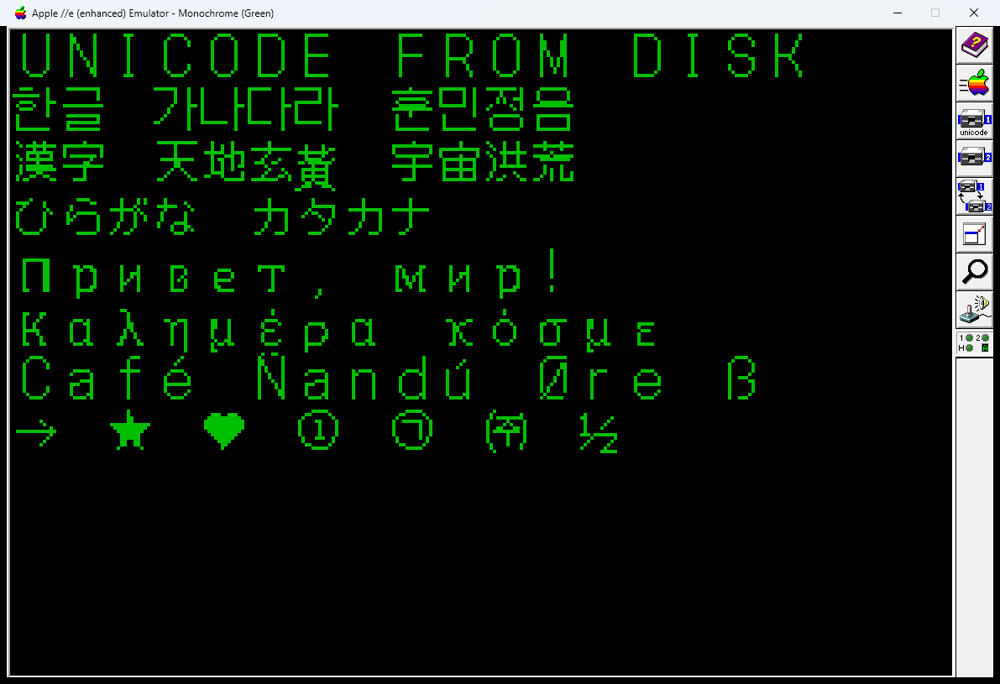

### 1. The disk image
[`unicode.hdv`](unicode.hdv) in this repository is ready to use: a 32 MB ProDOS hard disk (ProDOS order, the raw image a `.po` also is) with ProDOS 2.4.3, BASIC.SYSTEM, the driver and the whole font. To build it again (after changing the driver or the font):
```bash
python build_hdd.py --prodos ProDOS_2_4_3.po                      # unicode.hdv, 32 MB
python build_hdd.py --prodos ProDOS_2_4_3.po --size 800K --out build/unicode_800k.po
```
`--prodos` is a ProDOS 2.4.x disk (from [prodos8.com](https://prodos8.com) or AppleWin's folder): `PRODOS`, `BASIC.SYSTEM` and its boot blocks are copied from it. The image holds:

| File | |
| :--- | :--- |
| `STARTUP` | Loads the driver and says whether the font was found |
| `UNICODE` | The driver (`UNICODE.BIN`, `$4000`) |
| `UFONT` | The 14×16 glyph of each code point at offset code point × 32. A sparse 2 MB file: only blocks with glyphs take disk space |
| `HDDEMO`, `JEMANG` | Demo programs |

| `--size` | Glyphs | Disk used |
| :--- | :--- | :--- |
| `32M` (65,535 blocks, default) | 34,596: ASCII, Latin, Greek, Cyrillic, symbols, kana, Hangul compatibility jamo, all 11,172 Hangul syllables, 20,992 CJK Unified Ideographs | 1.1 MB |
| `800K` (1,600 blocks) | 13,238: the same without Hanja (spread over 20,992 code points they need about 1,300 blocks) | 477 KB |

`--font` picks the font chain (default `Galmuri14.ttf, NotoSerifCJK16.ttf`).

**Putting it on the machine**
- **CFFA3000, Floppy Emu**: copy `unicode.hdv` onto the card as it is.
- **CFFA / MicroDrive partition, SCSI disk**: write it with CiderPress or ADTPro.
- **AppleWin**:
  - Open **Configuration (F10) → [Slots] tab → Slot 7: Hard disk controller**.
  - Click the **HDD 1** icon (the rectangular hard-disk icon on the right toolbar) and select `unicode.hdv`.  
    *(Caution: Do NOT insert into floppy Drive 1 at the top, or it will fail with `unsupported_hdv`. If you see an `already mounted in slot 7, drive 2` warning, right-click the HDD 2 icon to unplug it, or click the [Swap] button in the Slot 7 dialog).*
  - Ensure floppy Drive 1 is empty (right-click to Eject if loaded), then press **`F2`** to reboot from the hard disk.
  - Or launch directly via command line:
    ```powershell
    & "AppleWin.exe" -s7 hdc -h1 unicode.hdv
    ```
- **STM32F769I-DISCO //e** ([STM32F769I-DISCO Apple II emulator](https://github.com/mildstorm/STM32F769I-DISCO)): its SmartPort card in slot 7 runs a `.HDV`/`.PO` image from the SD card. Upload it while the board runs, then choose it on the board's command line (TCP 2323); the choice is kept on the SD card:
  ```powershell
  .\tools\sd-upload.ps1 ..\..\apple2-unicode-bridge\unicode.hdv -Name UNICODE.HDV
  ```
  ```
  a2> hd UNICODE.HDV
  ```
  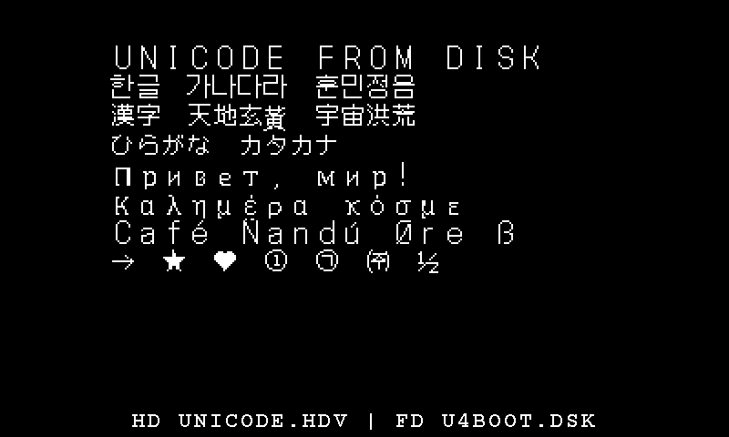

### 2. How the driver uses it
- At `CALL 16384` the driver checks for ProDOS (BASIC.SYSTEM's `$3D0` vector points to `$BExx`). It then takes input through `VECTIN` instead of DOS 3.3's `$AA55`, and opens `UFONT`. A name without `/` is looked up from the ProDOS prefix, or else from the volume the driver was loaded from.
- An `&` string is drawn from the `$6000` cache first, then from `UFONT`, then (if neither is there) by the server. For each character the driver seeks to code point × 32 and reads 32 bytes; ProDOS reads one block per glyph, which a CF card or hard disk returns in milliseconds. The file is opened by the first glyph of a statement and closed at its end, so `CLOSE` in BASIC never finds it open.
- The offline path also draws ASCII outside `\K…\N` and 1- and 2-byte UTF-8 inside it (Latin, Greek, Cyrillic) from `UFONT`.

| Address | |
| :--- | :--- |
| `16387` (`$4003`) | 1 when `UFONT` opened at `CALL 16384`. `POKE 16387,0` sends `&` strings to the server again (old Hangul composition, coloured text) |
| `16388` (`$4004`) | The font file's pathname: a length byte, then up to 63 characters (default `UFONT`); `CALL 16384` again after changing it |
| `16452` (`$4044`) | The ProDOS error of the last failed font-file call (e.g. 70 = file not found), 0 if none |
| `16453` (`$4045`) | What `Ctrl+K` composes with: 0 on the Apple II (default, needs `UFONT`), 1 the PC server over the SSC |

Under ProDOS the driver takes its 1 KB file buffer from BASIC.SYSTEM (`GETBUFR`), so HIMEM drops from 38400 to 37376 (`$9200`). The driver itself fills `$4000`–`$5EFF`.

Without the server, old Hangul syllables (which need HarfBuzz) and the coloured-text rasteriser are not available. `Ctrl+K` composes on the Apple II (2-Bul-Sik and Hanja; see below), or through the server with `POKE 16453,1`. `python tools/test_hdd_live.py [image]` boots an image in AppleWin, runs both demos and puts AppleWin's settings back afterwards.

### 3. How to Input Korean After Hard-Disk Boot (`unicode.hdv`)

After booting `unicode.hdv`, both drawing and 2-Bul-Sik typing work **with no PC and no serial card**:

1. **Drawing**: `UFONT` holds about 34,600 glyphs, so `RUN HDDEMO`, `RUN JEMANG` and any program's `&` strings draw on the Apple II alone.
2. **Typing with `Ctrl+K` (onboard, the default)**:
   - At the `]` prompt, type `10 & "` and press **`Ctrl+K`**. The input line opens at the bottom with `[한]`.
   - Type in 2-Bul-Sik (`gksrmf` → 한글). What is being composed shows inverse; Backspace takes back one jamo; `Ctrl+K` switches 한 ↔ A.
   - **Hanja**: `Ctrl+J` (or ↓) shows the candidates for the syllable being composed (or the one before the cursor) above the line: `1`–`9` picks, `Space` / → / ↓ next page, ← / ↑ previous, `Esc` closes the list. They are read from `UFONT`, most common first.
   - **`Return`** puts the line into BASIC as hex-safe `\K…\N`, **`Esc`** cancels. Close the quotes with `"`, press Return, then `RUN`.
   - Caps Lock may be on or off; turn it off for ㄲ ㄸ ㅃ ㅆ ㅉ ㅒ ㅖ (Shift).
3. **With the server over the SSC (when needed)**: `POKE 16453,1`, and `Ctrl+K` goes to `unicode_server.py` as on the DOS 3.3 floppy, for Japanese kana, Russian and Greek (`Ctrl+L`), PC input and paste (`Ctrl+P`). Terminal mode (`&` alone) and drawing through the server (`POKE 16387,0`: old Hangul, colour) need it too. `POKE 16453,0` goes back to onboard.
   - **SSC setup**: **AppleWin**: **Configuration (F10) → [Serial] tab**, **Slot 2 Serial Port** = **`TCP`** (port 1977). **Real hardware**: a **Super Serial Card** in **Slot 2**, a cable to the PC, `python unicode_server.py --com COMx` (`python unicode_server.py` for AppleWin).

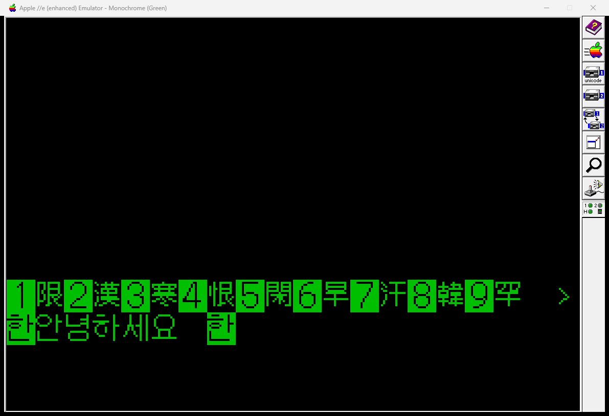

---

## 🔤 Font Engine: Retro Pixel Fonts & Scalable Vectors

`apple2-unicode-bridge` accommodates both **Vector Outlines** and **Pixel/Bitmap Fonts** within the low-resolution 14×16 Apple II HGR grid:

* **Pixel / Bitmap TTF Fonts (Recommended for Authentic Retro Aesthetic)**:  
  Fonts such as **Galmuri14** and **Neo둥근모** are designed on integer pixel grids. When rendered in 1-bit monochrome, they produce razor-sharp, hand-tuned retro glyphs without stroke collisions or dropped lines.
* **Vector Outline TTF Fonts (Universal Multilingual Coverage)**:  
  Fonts like **Noto Serif CJK** or system fonts provide complete worldwide Unicode coverage (thousands of characters across CJK, Cyrillic, Greek, Arabic, Latin).
* **Embedded Bitmap Strikes (`EBDT` / `sbit`)**:  
  Fonts like Windows **굴림 (`gulim.ttc`)** contain built-in 14×14 1-bit monochrome bitmaps for Hangul and Hanja, which FreeType uses automatically.

### Bundled Font Library (`fonts/`)

All bundled fonts are under open licences (SIL OFL or MIT), free for commercial and non-commercial use.

| Font File | Type | Target Grid | Characteristics | License | Source |
| :--- | :--- | :--- | :--- | :--- | :--- |
| **`Galmuri14.ttf`** | Pixel TTF | 14×14 | **Recommended default for HGR.** Crisp Korean glyphs with ideal 1-line top & bottom margins in 14×16 cells (`--y-offset 1`). | SIL OFL 1.1 | [quiple/galmuri](https://github.com/quiple/galmuri) |
| **`Galmuri11.ttf`** | Pixel TTF | 11×11 | Compact pixel font, ideal for dense layouts or 80-column style Apple II displays. | SIL OFL 1.1 | [quiple/galmuri](https://github.com/quiple/galmuri) |
| **`Galmuri9.ttf`** | Pixel TTF | 9×9 | Ultra-compact micro pixel font for status bars and HUDs. | SIL OFL 1.1 | [quiple/galmuri](https://github.com/quiple/galmuri) |
| **`neodgm.ttf`** | Pixel TTF | 16×16 | **Neo둥근모.** The legendary 1990s Korean MS-DOS aesthetic (Hanme Taja, Iyagi). Full 16-row height with thick, bold retro strokes. | SIL OFL 1.1 | [neodgm/neodgm](https://github.com/neodgm/neodgm) |
| **`Sam3KRFont.ttf`** | Pixel TTF | 16×16 | **삼국지3 한글 글꼴.** Faithful reproduction of the classic Koei Romance of the Three Kingdoms III Hangul bitmap font. | MIT License | Damheo Lee ([hurss/fonts](https://github.com/hurss/fonts)) |
| **`DOSGothic.ttf`** | Pixel TTF | 16×16 | **도스고딕.** Classic Korean MS-DOS Gothic monospace pixel font. | MIT License | Damheo Lee ([hurss/fonts](https://github.com/hurss/fonts)) |
| **`DOSMyungjo.ttf`** | Pixel TTF | 16×16 | **도스명조.** Classic Korean MS-DOS serif (myeongjo) pixel font. | MIT License | Damheo Lee ([hurss/fonts](https://github.com/hurss/fonts)) |
| **`NotoSerifCJK16.ttf`** | Vector TTF | Scalable | Full CJK Unicode vector font covering Hangul, Hanja, Japanese Kana, Cyrillic, Greek, and Latin diacritics. | SIL OFL 1.1 | Google / Adobe |

### Font Customization, Auto-Detection & Manual Overrides

Both `unicode_server.py` and `build_font_dsk.py` feature **smart auto-detection** alongside full manual override flags:

#### 1. Zero-Configuration Mode (Automatic Detection)
When you omit `--size`, `--y-offset`, or `--box-center`, the engine automatically detects the font's native pixel grid and applies optimal padding:
```bash
# Auto-detects 14px with 1-line top margin (ideal for 14x14 in 14x16 cell)
python unicode_server.py --font Galmuri14.ttf

# Auto-detects 16px native height and centers vertically
python unicode_server.py --font neodgm.ttf

# Auto-detects 11px / 9px native size and centers vertically
python unicode_server.py --font Galmuri11.ttf
```

#### 2. Manual Override Examples
You can explicitly override any parameter whenever desired:
```bash
# Force custom size (e.g., scale Neo둥근모 down to 14px, or scale NotoSerif to 16px)
python unicode_server.py --font neodgm.ttf --size 14
python unicode_server.py --font NotoSerifCJK16.ttf --size 16

# Custom vertical shift (e.g., push glyph down by 2 pixels)
python unicode_server.py --font Galmuri14.ttf --y-offset 2

# Force box-centering or force pure vector outline rasterization
python unicode_server.py --font Galmuri14.ttf --box-center
python unicode_server.py --font NotoSerifCJK16.ttf --force-vector
```

#### 3. Multi-Font Fallback Chaining
You can supply a comma-separated list of TTF fonts to create an automatic glyph fallback chain:
```bash
# Prioritize Galmuri14 for clean Hangul, Sam3KRFont for retro Hanja, and NotoSerif for universal Unicode
python unicode_server.py --font "Galmuri14.ttf, Sam3KRFont.ttf, NotoSerifCJK16.ttf"

# Also supported during offline DSK font subsetting:
python build_font_dsk.py --font "Galmuri14.ttf, neodgm.ttf, Sam3KRFont.ttf"
```
When rendering a character, the engine searches the faces in order: if a glyph is missing in the primary font, it seamlessly falls back to the secondary and tertiary fonts. You get the crispness of a Hangul pixel font together with the wide Hanja coverage of a large CJK font. The fonts are also registered in that order as slots `1`, `2`, `3`… and under their file names.

#### 4. Dynamic Font Registration, Modification, Removal & Display
Rather than being restricted to rigid pre-registered configurations, the engine provides a fully dynamic font slot/alias registry. You can register, modify, or unregister any font slot on the fly:

* **Register & Modify (`/font-add` or `/alias`)**:
  Assign or update font slots (numbers or custom names):
  ```basic
  10 & "/font-add 1 neodgm.ttf"        : REM Slot 1 mapped to Neo둥근모
  20 & "/font-add title Sam3KRFont.ttf": REM Alias 'title' mapped to 삼국지3
  30 & "/font-add body Galmuri14.ttf"  : REM Alias 'body' mapped to Galmuri14
  40 & "/font-add 1 DOSMyungjo.ttf"    : REM Dynamically modify Slot 1 to DOS Myungjo!
  ```
  *(Also supported at CLI launch: `--font "1=neodgm.ttf, title=Sam3KRFont.ttf, body=Galmuri14.ttf"`)*.

* **Remove & Clear (`/font-del`, `/font-clear`)**:
  Unregister slots or reset custom mappings:
  ```basic
  50 & "/font-del title"   : REM Remove alias 'title' (/unalias also supported)
  60 & "/font-clear"       : REM Clear all registered font slots
  ```

* **Multi-Font Display via Inline Tags (`[F:...]` or `\F...\`)**:
  Switch fonts on the fly anywhere inside a string:
  ```basic
  70 & "[F:1]명조체 출력 [F:body]본문 갈무리 출력"
  80 & "[F:neodgm]둥근모 [F:Sam3KRFont]삼국지 [F:DOSGothic]도스고딕"
  90 & "\F1\슬롯 1번 폰트 \F:body\본문 폰트"
  ```

* **Change Default Font (`/font <name>`)**:
  ```basic
  100 & "/font 1"
  110 & "ALL SUBSEQUENT LINES WILL RENDER IN SLOT 1"
  120 & "/font body"
  130 & "FROM HERE ON, LINES RENDER IN THE BODY FONT"
  ```

* **Example Font Assets (`fonts/` directory)**:
  Bundled fonts (`Galmuri14.ttf`, `neodgm.ttf`, `Sam3KRFont.ttf`, `DOSMyungjo.ttf`, `DOSGothic.ttf`, `Galmuri11.ttf`, `Galmuri9.ttf`, `NotoSerifCJK16.ttf`) serve as ready-to-use example assets that can be mapped to any slot or referenced directly by filename.

> [!TIP]
> Both the **PC Font Server streaming mode** and the **Standalone Floppy DSK offline mode** support this exact same dynamic syntax! When baking a DSK with `build_font_dsk.py`, the builder inspects `/font-add`, `/font-del`, and `[F:...]` commands, generating the appropriate glyphs into the `$6000` cache.

### Multi-Font & Multi-Size Showcase: `RUN DEMO`

When running `DEMO` on the Apple II (`RUN DEMO`), the system demonstrates its ability to display **multiple distinct fonts and sizes on the same screen, line by line**:

| Line (Row) | Font Name | Pixel Size | Type | Rendered Text Preview |
| :---: | :--- | :---: | :---: | :--- |
| **Row 1** | **`Galmuri14`** | 14 px | Pixel | `[GALMURI14] 안녕하세요애플투` |
| **Row 2** | **`Neo둥근모`** | 16 px | DOS pixel | `[NEODGM 16] 도스타자방이야기` |
| **Row 3** | **`삼국지3글꼴`** | 16 px | Classic Hanja/Hangul | `[SAM3K  16] 三國志英雄崛起` |
| **Row 4** | **`도스명조`** | 16 px | Serif pixel | `[MYUNGJO16] 붓글씨고전바탕` |
| **Row 5** | **`Galmuri11`** | 11 px | Compact pixel | `[GALMURI11] 조밀한작은폰트` |
| **Row 6** | **`Galmuri9`** | 9 px | Micro pixel | `[GALMURI 9] 초소형모니터화면` |
| **Row 7** | **`NotoSerifCJK`** | 14 px | Vector outline | `[NOTOSERIF] 漢字萬國훈민정음` |
| **Row 8** | *System* | 7×16 | ASCII | `1977 - 2026 RETRO COMPUTING` |

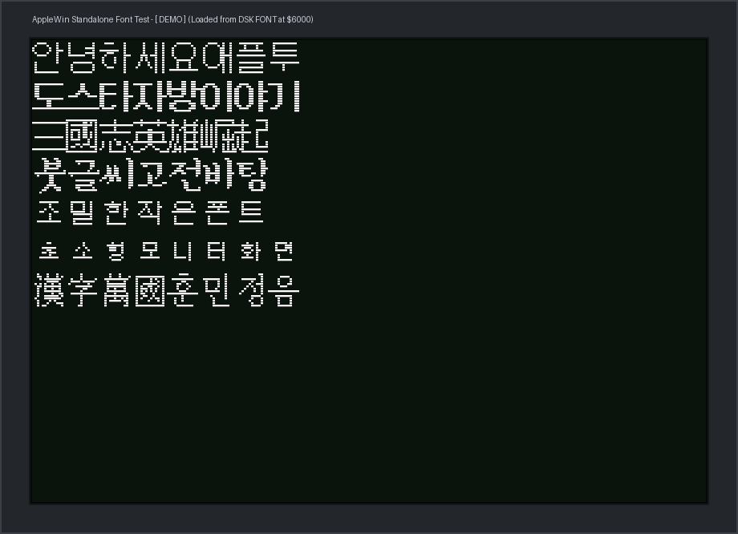

### Previewing & Comparing Fonts (`tools/preview_fonts.py`)

Run the font preview utility to render and compare all fonts side-by-side in both ASCII terminal format and as an exported high-resolution graphic comparison:

```bash
python tools/preview_fonts.py
# Saves side-by-side comparison to docs/images/font_comparison.png
```

---

## 🎨 Practical Multi-Font Guide

This section provides practical patterns, real-world Applesoft BASIC code examples, and instructions on **how to effectively combine, switch, and deploy multiple fonts** in Apple II games, utilities, and software.

### 1. Bringing Your Own Custom TTF Fonts
Beyond the bundled example fonts, you can use any TrueType or OpenType font (`.ttf`, `.otf`) of your choice:
1. Place your `.ttf` file into the `fonts/` directory (or use its absolute/relative path).
2. Register the font dynamically using `/font-add` either in your BASIC program or via the CLI:
   ```basic
   10 & "/font-add 1 NanumGothic.ttf"
   20 & "/font-add myfont C:\Windows\Fonts\batang.ttc"
   ```

---

### 2. Real-World Use Cases & Complete Applesoft BASIC Code

#### Scenario A: Classic RPG Dialogue System (Multi-Font Composition)
Elevate your Apple II software aesthetics by styling the game title, character name, spoken dialogue, and HUD with dedicated typefaces:
* **Title / Location**: Grand classical Hanja/Hangul Koei Romance of the Three Kingdoms III font (`[F:title]`)
* **Speaker Name**: Elegant traditional Korean brush serif MS-DOS Myeongjo (`[F:speaker]`)
* **Spoken Dialogue**: Crisp, readable 14px pixel font Galmuri14 (`[F:body]`)
* **Status Bar / HUD**: Compact 9px micro pixel font Galmuri9 (`[F:hud]`)

```basic
10 REM ====================================================
20 REM  Classic RPG Multi-Font Dialogue Window Example
30 REM ====================================================
40 & "/font-add title Sam3KRFont.ttf"
50 & "/font-add speaker DOSMyungjo.ttf"
60 & "/font-add body Galmuri14.ttf"
70 & "/font-add hud Galmuri9.ttf"
80 & "/clear"
90 & "[F:title]\K[ 長安城 皇宮 ]\N"
100 & ""
110 & "[F:speaker]\K제갈공명(諸葛孔明):\N"
120 & "[F:body]\K주공, 동남풍(東南風)이 불기 시작했습니다.\N"
130 & "[F:body]\K지금 즉시 화공(火攻)을 명하셔야 합니다!\N"
140 & ""
150 & "[F:hud]\KHP: 950/950  MP: 320/320  GOLD: 12500 G  TURN: 42\N"
160 END
```

#### Scenario B: In-Sentence Keyword Highlighting via Inline Tags
Using `[F:slot]` inline tags lets you switch fonts mid-sentence without forcing a newline:
```basic
10 & "[F:body]\KThe hero obtained \N[F:title]\K傳說의 寶劍\N[F:body]\K!\N"
20 & "[F:neodgm]\KStandard dialogue text \N[F:speaker]\K[IMPORTANT NOTICE]\N[F:neodgm]\K returns to normal.\N"
```

#### Scenario C: Memory-Efficient Font Slot Reuse (Scene Transitions)
You can dynamically modify and reassign existing font slots on the fly to conserve memory across game chapters:
```basic
100 REM [Town Scene] - Map Slot 1 to peaceful Gothic font
110 & "/font-add 1 DOSGothic.ttf"
120 & "[F:1]\KWelcome to the village tavern.\N"
...
200 REM [Dungeon Scene] - Reassign Slot 1 to dramatic Myeongjo!
210 & "/font-add 1 DOSMyungjo.ttf"
220 & "[F:1]\KA dark iron gate creaks open in the subterranean dungeon...\N"
```

---

### 3. Standalone Floppy (DSK) Multi-Font Storage & Offline Execution

> **Q. If my program uses multiple fonts, can it run completely standalone on a real Apple II without the PC serial connection?**  
> **A. Yes, 100%!**

Programs utilizing multiple fonts can be baked directly into the floppy disk image:

1. **One-Command Subsetting & Packaging**:
   ```bash
   python build_font_dsk.py --dsk unicode.dsk
   ```
2. **How It Works (Automated Multi-Font Subsetting)**:
   - `build_font_dsk.py` scans your BASIC programs and tracks every `/font-add`, `/font-del`, and `[F:...]` tag.
   - For each character, it invokes the respective font engine (e.g., characters tagged `[F:title]` are rendered using `Sam3KRFont.ttf`, while characters tagged `[F:body]` are rendered using `Galmuri14.ttf`).
   - All extracted 14×16 glyph bitmaps are merged into a single compact `$6000` binary (`FONT`) and injected into the DSK image.
   - The disk's `HELLO` boot script is automatically patched with `BLOAD FONT`.
3. **Result**:
   - Boot `unicode.dsk` in AppleWin or insert it into a real Apple II disk drive. Type `RUN YOURPROG`.
   - All designated fonts render instantly and accurately from local Apple II RAM at full hardware speed with **zero PC or serial connection required**!

---

### 4. Multi-Font Command & Syntax Cheat Sheet

| Command / Tag | Example Syntax | Description |
| :--- | :--- | :--- |
| **`/font-add` (Number)** | `& "/font-add 1 neodgm.ttf"` | Maps font to Slot 1 (updates slot if already registered) |
| **`/font-add` (Alias)** | `& "/font-add title Sam3KRFont.ttf"` | Maps font to custom alias (`title`, `body`, `hud`, etc.) |
| **`/font-del`** | `& "/font-del title"` | Unregisters slot or alias (`/unalias` also supported) |
| **`/font-clear`** | `& "/font-clear"` | Resets all registered custom font slots |
| **`/font`** | `& "/font 1"` or `& "/font body"` | Switches default font for subsequent lines |
| **`[F:...]` (Inline)** | `& "[F:1]Hangul [F:title]Hanja"` | Inline font switching anywhere inside a string |
| **`\F...\` (Inline)** | `& "\F1\Hangul \F:title\Hanja"` | Alternative backslash syntax for inline switching |
| **`--font` (CLI)** | `--font "1=neodgm.ttf, title=Sam3KRFont.ttf"` | Pre-registers slots at server launch |
| **Fallback Chaining** | `--font "Galmuri14.ttf, Sam3KRFont.ttf"` | Automatically searches fallback fonts when glyphs are missing |

---

## 🌈 Apple II HGR Color Support & Drawing Modes (Overlay / Replace / XOR)

Maximize the visual power of Apple II High-Resolution Graphics (280×192) by bringing **vibrant typography colors** and **overlay drawing over existing graphic scenes** without erasing the background!

### 1. Apple II HGR Color System

The Apple II generates color on color composite monitors through artifact coloring (NTSC subcarrier phase timing) governed by even/odd pixel column placement and high-bit palette selection (`$80`). The bridge driver and streaming server automatically handle column bit-pattern transformations ($2A, $55, $D5, $AA) so you can simply select colors by name or digit:

| Color Code | Name (Case-insensitive) | Aliases | Palette & Characteristics |
| :---: | :--- | :--- | :--- |
| **0** (or 4) | **`black`** | `bk` | Black (Palette 0 / 1) |
| **1** | **`green`** | `g` | Green (Palette 0, Bit 7 = 0) |
| **2** | **`violet`** | `purple`, `p`, `v` | Violet / Purple (Palette 0, Bit 7 = 0) |
| **3** (or 7) | **`white`** | `w` | White (Palette 0 / 1, All bits ON) |
| **5** | **`orange`** | `red`, `o`, `r` | Orange (Palette 1, Bit 7 = 1) |
| **6** | **`blue`** | `cyan`, `b`, `c` | Blue / Cyan (Palette 1, Bit 7 = 1) |

*Applesoft BASIC's standard `HCOLOR=x` command is also automatically synced whenever an `&` command executes.*

**How coloured text is drawn**: a coloured HGR dot is every other dot (two side by side are white), so a 14-dot cell holds only 7 coloured dots across. Folding the 14-dot white glyph into them merged and broke strokes. The server now rasterises coloured characters for those 7 columns from a vector font at 8×15 (Malgun Gothic by default, then system CJK fonts; `--color-font` to choose), one coloured dot per column, in the colour's phase. White text keeps the full 14-dot glyph. Characters no colour font has (and old Hangul syllables) are still folded the old way.

The same `[C:...]` lines before (top) and after (bottom), captured from an emulated Apple //e's LCD (STM32F769I-DISCO, pixel-exact colour decoding, which shows each coloured dot one dot wide; a composite monitor or AppleWin's Color TV mode spreads it, so horizontal strokes look solid there):

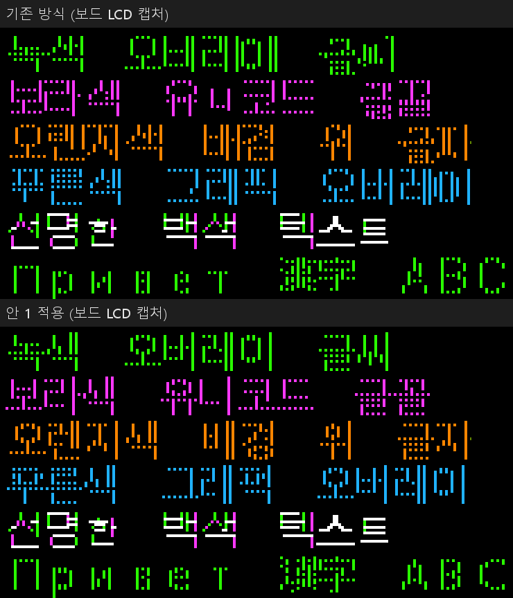

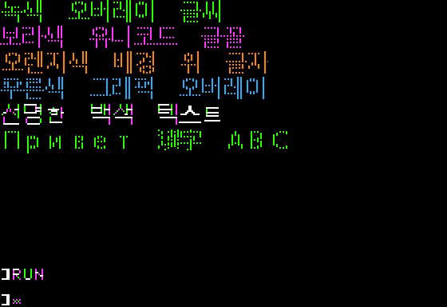

---

### 2. Drawing Modes (Replace vs Overlay vs XOR)

| Drawing Mode | ID | 6502 Op | Behavior & Recommended Use Case |
| :--- | :---: | :---: | :--- |
| **`replace`** | `0` | `STA` | **Default**. Clears the 14×16 character bounding cell to black before rendering the glyph. Delivers crisp, maximum legibility. |
| **`overlay`** | `1` | `ORA` | **Preserves background graphics**. Bitwise ORs glyph strokes directly over the existing HGR screen without erasing grids, charts, maps, or background game art. |
| **`xor`** | `2` | `EOR` | **Inverts background pixels**. Bitwise XORs character bitmap with underlying screen pixels. Ideal for inverted selection cursors and highlights. XORed in the colour of a colour area, text is cut out of it in black. |

In overlay and XOR modes a byte the glyph has no dots in is left untouched, palette bit included; where the glyph draws, its palette bit is ORed with the background's. White text keeps an orange or blue background orange or blue, and orange or blue text keeps its colour on black.

> [!TIP]
> White text ORed onto a solid colour area loses about half its dots: the area already has every other dot lit. For text on a colour area, XOR in that area's colour (black text cut out of it), or clear a box with `replace`.

---

### 3. Command Syntax & Inline Style Tags

#### (1) Global Slash Commands
Set drawing attributes across the entire line:
```basic
10 & "/color green"      : REM Sets font color (green, violet, white, orange, blue, 0~7)
20 & "/mode overlay"      : REM Sets draw mode to overlay (overlay, replace, xor, 0, 1, 2)
30 & "/overlay"           : REM Shortcut for /mode overlay
40 & "/replace"           : REM Shortcut for /mode replace
50 & "/xor"               : REM Shortcut for /mode xor
60 & "/pos 2 5"           : REM Moves cursor to Column 2 (28px), Row 5 (80px)
70 & "/clear"             : REM Clears HGR screen and resets cursor to (0,0)
```

#### (2) Inline Style Tags
Switch color or drawing mode mid-sentence without line breaks:
* **Color Tags**: `[C:green]`, `[C:orange]`, `[C:blue]`, `[C:violet]`, `[C:white]`, `[COLOR:1]`, `\C:1\`
* **Mode Tags**: `[M:overlay]`, `[M:replace]`, `[M:xor]`, `[MODE:1]`, `\M:overlay\`

```basic
10 & "[C:orange][M:overlay]\KWARNING!\N [C:green]System online.\N"
20 & "[C:white]\KClear box: \N[M:replace][C:blue]\KThis text clears background\N"
```

---

### 4. Live Demonstration: `RUN COLORDEMO`

The included `COLORDEMO` program (written by `tools/create_color_overlay_demo.py`) draws four colour ribbons and cuts Korean text out of each in black by XORing it in the ribbon's own colour, each ribbon in a different font, then prints white text on black in replace mode (text shown decoded; the program holds it as `\K...\N` hex):

```basic
10 REM *** GORGEOUS APPLE II MULTI-COLOR DEMO ***
20 HGR : HCOLOR=6: FOR Y=0 TO 17: HPLOT 0,Y TO 279,Y: NEXT Y
30 & "/pos 1 0" : & "/xor" : & "[F:sam3k][C:blue]★ 애플 II 멀티폰트 데모 ★"
40 HCOLOR=1: FOR Y=32 TO 49: HPLOT 0,Y TO 279,Y: NEXT Y
50 & "/pos 1 2" : & "/xor" : & "[F:neodgm][C:green]녹색 리본: 둥근모 레트로 타자체"
60 HCOLOR=5: FOR Y=64 TO 81: HPLOT 0,Y TO 279,Y: NEXT Y
70 & "/pos 1 4" : & "/xor" : & "[F:dosmyungjo][C:orange]주황 리본: 품격있는 도스명조체"
80 HCOLOR=2: FOR Y=96 TO 113: HPLOT 0,Y TO 279,Y: NEXT Y
90 & "/pos 1 6" : & "/xor" : & "[F:galmuri14][C:violet]보라 리본: 선명한 갈무리 본문체"
100 & "/pos 1 8"  : & "/replace" : & "[F:galmuri11][C:white]블랙 바탕: 갈무리11 폰트"
110 & "/pos 1 9"  : & "/replace" : & "[F:galmuri9][C:white]HUD: 초소형 갈무리9 폰트"
120 END
```

Standalone, from the `$6000` font cache on the disk (the 6502 driver folds the 14-dot glyphs into the colour's dots itself, and skips ASCII letters):

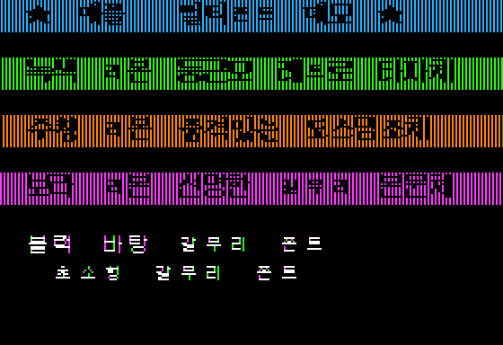

With the PC server streaming the glyphs (`POKE 24576,0` first to bypass the cache), coloured text drawn for its 7 colour columns:

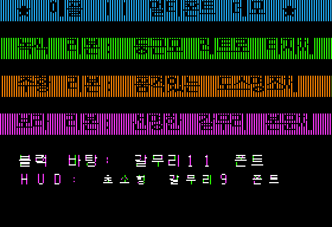

*Both captured from an emulated Apple //e's LCD (STM32F769I-DISCO, pixel-exact colour decoding, which shows each coloured dot one dot wide, hence the striped ribbons; a composite monitor shows them solid).*

---

## 🎧 Cassette Input: the Font Cache Without a Serial Card or Disk

An Apple II with no Super Serial Card and no disk of fonts can still take a font cache through its **cassette input**, from the PC's headphone or line output. `& "/TAPE"` reads it into `$6000`; after that `&` strings draw from it as from a cache loaded off disk.

### 1. Format
The recording is in the standard Apple II cassette format, so the driver reads it with the monitor's own `READ` routine (`$FEFD`): a 770 Hz leader, a sync bit (one half cycle each of 2500 Hz and 2000 Hz), the bytes most significant bit first (0 = one cycle of 2000 Hz, 1 = one of 1000 Hz), then a checksum byte (`$FF` XOR every byte). There are two records, each after a 5-second leader (`READ` waits 3.5 seconds before it looks for the sync bit):
1. 3 bytes: the length of the cache and its checksum.
2. The cache itself (the `HG` table `build_font_dsk.py` makes), put at `$6000`.

`READ` prints `ERR` on a bad record but cannot tell the caller, so the driver checks the cache against the checksum from the first record and drops it (clears the `H` at `$6000`) if it does not match; `&` then never draws from a damaged cache. A cache of 137 glyphs (4,936 bytes) takes 34 seconds.

### 2. Sending it
```bash
# A WAV file to play into the cassette input of a real Apple II
python tools/audio_font_streamer.py --dsk unicode.dsk --wav font.wav [--play]

# The cache of only the characters a text uses
python tools/audio_font_streamer.py --text "안녕하세요 漢字" --wav font.wav

# Straight to an emulator that takes the cassette signal over TCP (the
# STM32F769I-DISCO //e, port 6503, as half-cycle lengths)
python tools/audio_font_streamer.py --dsk unicode.dsk --board 169.254.246.139 --src 169.254.139.170
```
On the Apple II, run `& "/TAPE"` first (from the prompt or a program; it works with or without the server, under DOS 3.3 or ProDOS), then start the playback. `READ` waits for the tone; Control-Reset stops it. With a disk font (`UFONT`) also on, the cache is used first; `POKE 16387,0` leaves only the cache.

> [!NOTE]
> AppleWin does not feed anything to the cassette input (`Tape.cpp: TapeRead` returns the floating bus), so this needs real hardware or an emulator that takes a cassette signal. It was checked on the STM32F769I-DISCO //e: the cache loaded, `&` drew from it with no server, and a recording with one bit changed was refused.

---

## 🤝 Contributing

Contributions to `apple2-unicode-bridge` are warmly welcomed! Areas of active exploration:
- Additional 6502 drivers for ProDOS and 80-column Double High-Resolution (DHGR 560×192) modes.
- Support for bidirectional text (Arabic, Hebrew) shaping engines on the host side.
- Pre-configured disk images for other retro machines with 6502/serial setups.

Please feel free to open an issue or submit a Pull Request!

---

## 📄 License

- **Source Code & Documentation**: Licensed under the [MIT License](LICENSE). Copyright (c) 2026 mildstorm.
- **Bundled Fonts**:
  - `Galmuri` series (`Galmuri14.ttf`, `Galmuri11.ttf`, `Galmuri9.ttf`): [SIL Open Font License 1.1](fonts/README.md) by quiple.
  - `Neo둥근모` (`neodgm.ttf`): [SIL Open Font License 1.1](fonts/README.md) by Dalgona.
  - `Sam3KRFont.ttf`, `DOSGothic.ttf`, `DOSMyungjo.ttf`: [MIT License](fonts/README.md) by Damheo Lee.
  - `NotoSerifCJK16.ttf`: [SIL Open Font License 1.1](https://scripts.sil.org/OFL) by Google / Adobe.

> 💡 **Developer Note**: Automated end-to-end regression tests can be executed via `python tools/test_all_operations.py`.
