# Apple II Unicode Bridge (`apple2-unicode-bridge`)

[](https://github.com/mildstorm/apple2-unicode-bridge)
[](LICENSE)
[](#)
[](#)

> **Apple II용 범용 TrueType / 유니코드 다국어 폰트 브리지 및 입출력 엔진**  
> 롬(ROM)이나 하드웨어를 전혀 고치지 않고, Super Serial Card(SSC)를 통해 한글, 한자, 일본어, 중국어, 키릴 문자, 그리스 문자, 라틴 확장 문자, 기호 등 전 세계 문자를 Apple II 고해상도 그래픽(HGR 280×192) 화면에 출력합니다.

[English](README.md) | [한국어 문서](README_HANGUL.md)

---

## 🌟 개요

Apple II의 원래 하드웨어는 1970년대 문자 생성 롬(ROM)에 묶여 있어, 40열 텍스트 화면에 7비트 US-ASCII 영문 대소문자만 표시할 수 있습니다. 라틴 문자가 아닌 문자를 쓰려면 지역별 호환기(한국의 삼보·세경, 일본의 J-Plus, 키릴 문자의 Pravets-8D 등)나 값비싼 전용 문자 생성기 확장 카드가 필요했습니다.

**`apple2-unicode-bridge`** 는 최신 PC의 폰트 처리 능력을 빌려 Apple II를 **범용 다국어 플랫폼**으로 바꿉니다:

1. **하드웨어·롬 수정 없음**: 슬롯 2의 표준 **Super Serial Card(SSC)** 를 사용합니다(에뮬레이터는 TCP 소켓, 실기는 RS-232/USB 시리얼).
2. **전 세계 유니코드 지원**: 한글(11,172자 전체), 한자·간지·중국 한자, 키릴, 그리스, 아랍, 라틴 확장 문자와 각종 기호를 FreeType으로 TrueType / OpenType 폰트에서 그때그때 래스터라이징합니다.
3. **Applesoft BASIC `&`(앰퍼샌드) 연동**: `10 & "\KHello World / 한글 / 漢字 / Привет / こんにちは\N"` 같은 문법으로 BASIC 프로그램 안에 다국어 문장을 바로 넣고 실행합니다.
4. **Hex 안전 인코딩**: Apple II의 8비트 입력 처리와 Caps Lock 때문에 생기는 BASIC 토큰 충돌($80–$EA)과 `?SYNTAX ERROR`를 막습니다.
5. **대화형 전체화면 터미널**: 키보드 입력, 한글 입력기(IME), 자동 줄바꿈을 지원하는 280×192 그래픽 콘솔을 제공합니다.
6. **Apple II 키보드로 입력**: BASIC 작성 중 `Ctrl+K`를 누르면 입력 줄이 열려, 2벌식 한글(한자 변환 포함)·일본어 가나·러시아어·그리스어를 Windows 입력기와 같은 방식으로 조합해 칠 수 있습니다([Ctrl+K](#2-ctrlk-입력-2벌식한자가나러시아어그리스어) 참고).

---

## 🏗️ 구조

```
+-------------------------------------------------------------+
|                       PC / Host System                      |
|                                                             |
|   +----------------------+       +----------------------+   |
|   |  FreeType / Pillow   | ----> |  unicode_server.py   |   |
|   |  TrueType Font (TTF) |       |  (TCP / COM Port)    |   |
|   +----------------------+       +----------------------+   |
+----------------------------------------------|--------------+
                                               |  Serial / TCP (Slot 2 SSC)
                                               v  9600-115200 Baud
+-------------------------------------------------------------+
|               Apple II (AppleWin or Real Hardware)          |
|                                                             |
|   +-------------------+         +-----------------------+   |
|   | 6551 ACIA (Slot 2)| ------> | UNICODE.BIN Driver    |   |
|   +-------------------+         | (Resident at $4000)   |   |
|                                 +-----------------------+   |
|                                             |               |
|                                             v               |
|                           +-------------------------------+ |
|                           | HGR Page 1 ($2000-$3FFF)      | |
|                           | 280 x 192 Multilingual Screen | |
|                           +-------------------------------+ |
+-------------------------------------------------------------+
```

### HGR 화면의 글자 크기와 배치
- **전각 문자(한글·한자 등)**: 14×16 픽셀 (20열 × 12행)
- **반각 문자(ASCII·라틴 등)**: 7×16 픽셀 (40열 × 12행)
- 픽셀 단위로 정확하게 래스터라이징하므로 컬러 모니터와 흑백 모니터 모두에서 왜곡 없이 깨끗하게 읽힙니다.

---

## 📺 실제 동작 화면: 祭亡妹歌 (제망매가) 한자 및 한글 혼용 출력

신라 향가 월명사의 *제망매가(祭亡妹歌)* 원문(한자/향찰)과 한글 풀이를 Apple II 고해상도 그래픽(HGR 280×192) 화면에 롬 수정 없이 동적으로 렌더링한 실제 화면입니다:

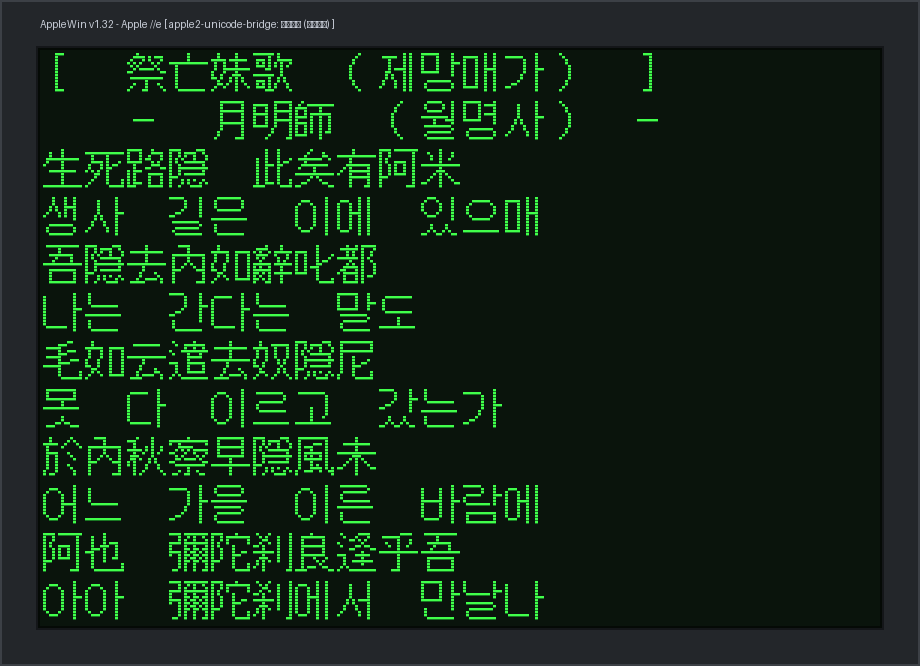

### Applesoft BASIC 프로그램

줄 번호와 `&` 확장 명령으로 Applesoft BASIC에서 바로 작성할 수 있습니다:

```basic
10 REM ====================================================
20 REM  祭亡妹歌 (제망매가) - 月明師 (월명사)
30 REM  Multilingual Hanja & Hangul Demo on Apple II HGR
40 REM ====================================================
50 & "\K[ 祭亡妹歌 (제망매가) ]\N"
60 & "\K  - 月明師 (월명사) -\N"
70 & "\K生死路隱 此矣有阿米\N"
80 & "\K생사 길은 이에 있으매\N"
90 & "\K吾隱去內如辭叱都\N"
100 & "\K나는 간다는 말도\N"
110 & "\K毛如云遣去奴隱尼\N"
120 & "\K못 다 이르고 갔는가\N"
130 & "\K於內秋察早隱風未\N"
140 & "\K어느 가을 이른 바람에\N"
150 & "\K阿也 彌陀刹良逢乎吾\N"
160 & "\K아아 彌陀刹에서 만날나\N"
```

### AppleWin에서 한자·다국어 문자 입력 방법:
1. AppleWin에서 `50 & "` 까지 타이핑합니다.
2. **`Ctrl+K`** 를 누른 뒤 **`Ctrl+P`** 를 눌러 PC에서 입력합니다. (Apple II 키보드로 쳐도 됩니다. 한글은 2벌식으로 치고, 한 글자씩 `Ctrl+J`로 한자로 바꿉니다. [Ctrl+K](#2-ctrlk-입력-2벌식한자가나러시아어그리스어) 참고)
3. PC에 입력 프롬프트(`--popup`이면 입력 창)가 나타나면 `[ 祭亡妹歌 (제망매가) ]`를 입력하거나 붙여 넣고 `Enter`를 누른 다음, Apple II에서 `Return`을 누릅니다.
4. 브리지가 Hex 안전 문자열 `\K[ 祭亡妹歌 (제망매가) ]\N`을 BASIC 입력 줄에 자동으로 넣어 줍니다.
5. 따옴표(`"`)를 닫고 `Enter`를 누릅니다.
6. `RUN`을 입력하면 Apple II가 곧바로 HGR 고해상도 그래픽으로 전환되어 글자를 그립니다.

---

## 📜 실제 동작 화면: 訓民正音 (훈민정음) 옛한글

*훈민정음*(1446) 서문은 옛한글로 쓰여 있습니다. 아래아(ㆍ), ᄊ ᄍ ᄠ ᇰ ᇙ 같은 옛 자모가 들어 있고, 완성형 코드가 없는 음절들입니다. 서버는 이어 쓴 자모를 HarfBuzz로 음절마다 모아 14×16 한 칸에 그리므로 풀어쓰기가 되지 않습니다([옛한글](#5-옛한글훈민정음-모아쓰기) 참고).

에뮬레이트된 Apple //e(STM32F769I-DISCO 보드, 흑백 모니터)의 LCD에서, 서버가 Super Serial Card로 글리프를 보내는 상태로 캡처했습니다:

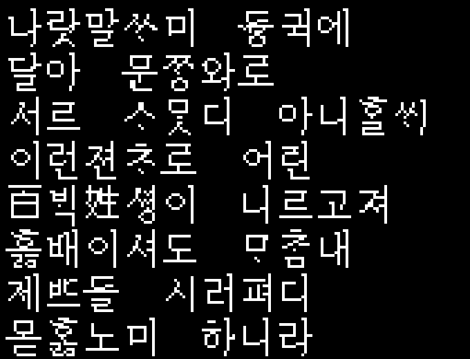

```basic
10 & "\KEB8298EB9E8FEBA790E1848AE1869EEBAFB820EB9380E187B0EAB781EC9790\N"
20 & "\KEB8BACEC958420EBACB8E1848DE1869EE186BCEC9980EBA19C\N"
30 & "\KEC849CEBA5B420E18489E1869EE18486E1869EE186BAEB949420EC9584EB8B88E18492E1869EE186AFE1848AE186A1\N"
40 & "\KEC9DB4EB9FB0ECA0BCE1848EE1869EEBA19C20EC96B4EBA6B0\N"
50 & "\KE799BEE18487E186A1E186A8E5A793EC8594E187B0EC9DB420EB8B88EBA5B4EAB3A0ECA0B8\N"
60 & "\KED98B8E18799EBB0B0EC9DB4EC8594EB8F8420E18486E1869EE1848EE1869EE186B7EB82B4\N"
70 & "\KECA09CE184A0E185B3EB93A420EC8B9CEB9FACED8EB4EB9494\N"
80 & "\KEBAAAFE18492E1869EE18799EB85B8EBAFB820ED9598EB8B88EB9DBC\N"
```

16진수 문자열은 다음 글의 UTF-8입니다:

```
나랏말ᄊᆞ미 듀ᇰ귁에 / 달아 문ᄍᆞᆼ와로 / 서르 ᄉᆞᄆᆞᆺ디 아니ᄒᆞᆯᄊᆡ / 이런젼ᄎᆞ로 어린
百ᄇᆡᆨ姓셔ᇰ이 니르고져 / 호ᇙ배이셔도 ᄆᆞᄎᆞᆷ내 / 제ᄠᅳ들 시러펴디 / 몯ᄒᆞᇙ노미 하니라
```

다른 유니코드 문자열처럼 16진수를 치는 대신 **`Ctrl+K`**, **`Ctrl+P`** 로 글을 붙여 넣어도 됩니다. 모아쓰기에는 `pip install uharfbuzz`가 필요합니다.

### 실행 방법 (AppleWin)

1. `uharfbuzz`를 포함해 Python 패키지를 설치합니다:
   ```bash
   pip install pillow freetype-py uharfbuzz
   ```
2. AppleWin의 **Configuration**에서 **Serial Port**를 **TCP**로 설정합니다. 그러면 슬롯 2의 Super Serial Card가 TCP 1977번 포트에서 기다립니다. 획을 가장 깔끔하게 보려면 **Video**를 **Monochrome** 계열로 설정합니다(컬러 모드는 1픽셀 획에 색 번짐이 생김).
3. 드라이브 1에 [`unicode.dsk`](unicode.dsk)를 넣고 부팅합니다. `HELLO`가 드라이버를 `$4000`에, 글꼴 캐시를 `$6000`에 읽어 들이고 `]` 프롬프트에서 멈춥니다.
4. PC 서버를 실행합니다. AppleWin의 1977번 포트에 접속합니다(실기는 대신 `--com COMx`):
   ```bash
   python unicode_server.py
   ```
5. `]` 프롬프트에서 디스크의 글꼴 캐시를 꺼서, 모든 `&` 문자열이 서버로 가게 합니다:
   ```basic
   POKE 24576,0
   ```
   *이 단계를 빼면 드라이버가 `HELLO`가 읽어 둔 `$6000` 캐시로 그립니다. 캐시는 UTF-8 글자 하나 단위로 글리프를 담고 있어서, 옛한글이 자모 단위로 풀어져 나옵니다.*
6. 위 프로그램을 입력하고(또는 `10 & "` 뒤에서 `Ctrl+K`, `Ctrl+P`로 각 줄의 글을 붙여 넣고) `RUN`합니다.

같은 프로그램을 AppleWin 1.32.1(Monochrome Green)에서 실행해 창을 캡처했습니다:

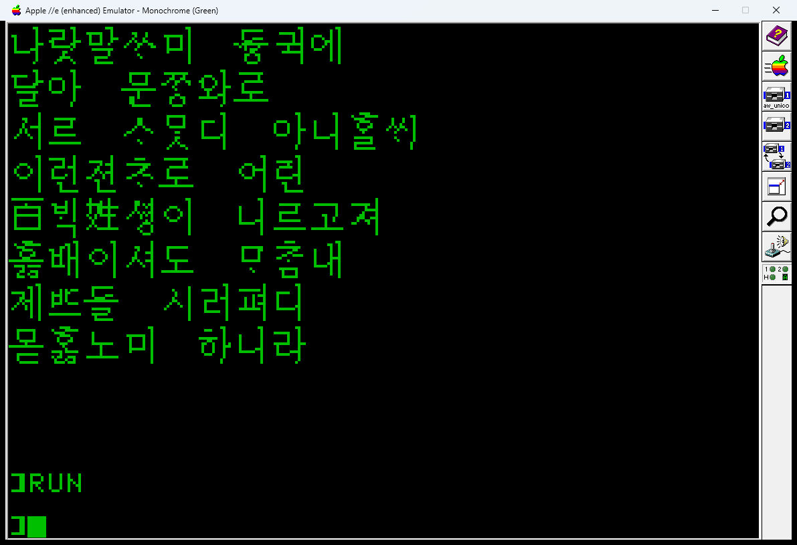

---

## 🚀 주요 기능

### 1. Applesoft BASIC 확장 (`&`)
Applesoft BASIC에서 바로 다국어 유니코드 문장을 출력할 수 있습니다:

```basic
10 & "\KWelcome to Apple II Unicode Bridge!\N"
20 & "\K한글과 漢字 및 다국어 폰트 출력\N"
30 & "\KHello, こんにちは, Привет, Bonjour!\N"
```
실행(`RUN`)하면 드라이버가 HGR 그래픽 모드로 전환하고, 글자 간격과 세로 정렬을 맞춘 고밀도 글리프를 그립니다.

### 2. `Ctrl+K` 입력 (2벌식·한자·가나·러시아어·그리스어)
BASIC 프로그램을 입력하다가 **`Ctrl+K`** 를 누르면 Apple II 키보드로 입력할 수 있습니다. 혼합 모드 HGR의 마지막 줄에 입력 줄이 열리고, 그 아래 텍스트 4줄이 보입니다. BASIC 줄이 화면 아래쪽에 있으면 함께 보입니다. Windows 입력기처럼 조합 중인 글자는 반전으로 보이고, 다음 키가 붙을 수 없을 때 확정됩니다.

| 모드(0번 칸) | 입력 | 예 |
| :--- | :--- | :--- |
| **한** 2벌식 | 표준 자판. Shift로 ㄲ ㄸ ㅃ ㅆ ㅉ ㅒ ㅖ를 칩니다(같은 키를 두 번 쳐도 쌍자음이 되지 않음). 백스페이스는 자모 하나씩 되돌립니다(과 → 고, 닭 → 달). | `dkssud` → 안녕, `ekfrk` → 달가, `rt` → ㄳ |
| **あ** / **ア** 가나 | 로마자를 히라가나/가타카나로 (Microsoft IME와 같은 규칙): `kka` → っか, 자음 앞의 `n`이나 `nn` → ん, `-` → ー, `,` `.` → 、。, `[` `]` → 「」 | `nihon` → にほん, `ko-hi-` → コーヒー |
| **Я** 러시아어 | ЙЦУКЕН 자판(`/`와 `?`는 `.`와 `,`) | `ghbdtn` → привет |
| **Ω** 그리스어 | 그리스어 자판. `;` 다음 모음은 강세(tonos), `:`는 분음 부호(dialytika) | `kalhm;era` → καλημέρα |
| **A** | 친 그대로 | |

| 키 | 동작 |
| :--- | :--- |
| `Ctrl+K` | 언어 ↔ A (한/영 키) |
| `Ctrl+L` | 다음 언어: 한 → あ → ア → Я → Ω (`--ime-langs ko,hira,kata,ru,el`로 고르고 순서를 정함, 첫 번째가 기본) |
| `Ctrl+J` (↓) | 조합 중인 글자나 커서 앞 글자를 **한자**로. 입력 줄 위에 후보가 나옵니다(읽기 486개, 한자 8,649자, 많이 쓰는 순). `1`–`9` 선택, `Space` / → / ↓ 다음 쪽, ← / ↑ 이전 쪽, `Return` 첫 후보, `Esc` 목록 닫기 |
| `Ctrl+P` | PC 입력(콘솔, `--popup`이면 창). 그 밖의 문자를 PC 입력기로 입력하거나 붙여 넣으면 입력 줄에 이어 붙습니다 |
| `Return` | Hex 안전 문자열 `\K…\N`으로 BASIC 줄에 넣기 |
| `Esc` | 취소 |

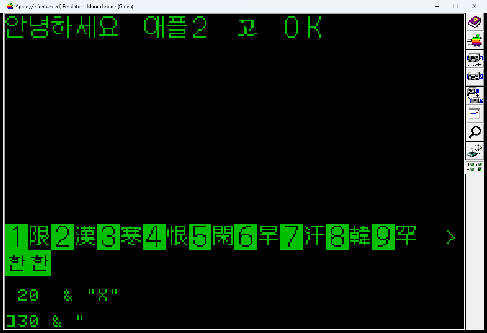

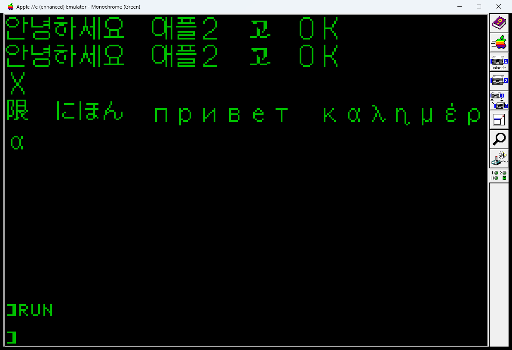

**Shift와 Caps Lock**: AppleWin이 같은 PC에서 돌면 서버가 PC의 Shift 키를 읽으므로 Caps Lock과 상관없습니다. 실기에서는 글자의 대소문자로 판단하므로 //e의 Caps Lock을 꺼야 합니다(소문자가 없는 II+에서는 Shift로만 치는 글자를 칠 수 없음).

한자는 한 글자씩 바꾸고, 가나는 가나로만 입력됩니다(가나→한자 변환은 없으니 일본어 한자는 `Ctrl+P`로). 한자표 `hanja_table.txt`는 `tools/build_hanja_table.py`가 유니코드 한자 데이터베이스(Unihan)로 만듭니다.

`python unicode_server.py --pc-input`으로 실행하면 예전처럼 `Ctrl+K`가 PC 입력을 바로 엽니다. 테스트: `python tools/test_dubeol_ime.py`(2벌식 규칙), `python tools/test_ime_engines.py`(가나·러시아어·그리스어·한자·모드 키), `python tools/test_ime_live.py`(AppleWin에서 줄을 입력해 화면 저장).

### 3. Hex 안전 스트림 프로토콜 (`\K ... \N`)
Apple II의 줄 입력 루틴(`GETLN`)과 Applesoft 키워드 해석기(`PARSE`)는 `$80`–`$FF` 바이트를 BASIC 내부 토큰이나 제어 코드로 취급합니다. UTF-8 바이트를 그대로 넣으면 곧바로 문법 오류가 납니다.
- **`apple2-unicode-bridge`** 는 유니코드 문장을 Hex/이스케이프 틀(`\K<HEX>\N`)에 담아 보냅니다.
- 따라서 Apple II의 `Caps Lock` 상태, 따옴표, 줄바꿈 처리의 영향을 전혀 받지 않습니다.

### 4. 대화형 터미널 모드
Applesoft 프롬프트 `]`에서 `&`만 입력하면 전체화면 대화형 그래픽 터미널로 들어갑니다:
- 한글 2벌식 입력기, 라틴 문자, 단축키를 지원합니다.
- `Ctrl+K` 또는 `` ` ``(백틱)으로 한글과 영문 입력을 바로 전환합니다.
- `ESC`로 Applesoft BASIC에 안전하게 돌아갑니다.

### 5. 옛한글(훈민정음) 모아쓰기
옛한글(아래아 ㆍ, 옛 자모, 방점)은 완성형 코드가 없어 음절을 조합형 자모(U+1100–11FF, U+A960–A97F, U+D7B0–D7FF)를 이어 써서 나타냅니다. 코드포인트 하나씩 그리면 풀어쓰기가 됩니다. 서버는 음절 하나를 HarfBuzz로 `NotoSerifCJK16.ttf`의 `ljmo/vjmo/tjmo` 기능에 맞춰 모아 14×16 한 칸에 그립니다(`old_hangul.py`). 옛한글이 든 문자열은 현대 음절도 같은 글꼴로 그립니다. 예: `10 & "\KEB8298EB9E8FEBA790E1848AE1869EEBAFB8\N"` → `나랏말ᄊᆞ미`가 다섯 칸으로 표시됩니다.
- `pip install uharfbuzz`가 필요합니다. 없거나 글꼴을 찾지 못하면 서버가 시작할 때 알리고 예전처럼 자모 단위로 그립니다.
- PC 서버 스트리밍에서만 됩니다. 독립 실행형 `$6000` `FONT` 캐시는 글자마다 UTF-8 3바이트를 키로 찾기 때문에, 그 경우 옛한글은 여전히 자모 단위로 그려집니다. `unicode.dsk`로 부팅한 뒤에는 먼저 `POKE 24576,0`을 실행해 문자열이 서버로 가게 하십시오([실행 방법](#실행-방법-applewin) 참고).

훈민정음 서문을 SSC로 에뮬레이트된 Apple //e(STM32F769I-DISCO 보드의 LCD, 흑백 모니터)에 보낸 화면입니다. 음절마다 한 칸입니다:

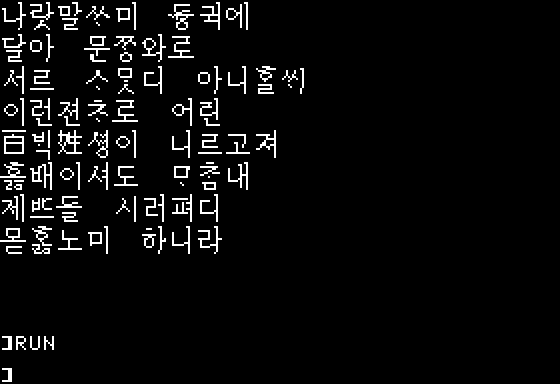

### 6. 폰트 서브셋으로 독립 실행 (PC 서버 불필요!)
PC 폰트 서버는 유니코드 글리프를 제한 없이 보내 주지만, BASIC 프로그램에서 실제로 쓰는 글자만 골라 `.dsk` 디스크 이미지에 넣어 둘 수도 있습니다:
- **PC 의존 없음**: 한 번 넣어 두면 Apple II가 플로피 디스크만으로 부팅해 다국어 그래픽 프로그램을 실행합니다.
- **아주 작은 용량**: *제망매가*와 `DEMO`에 쓰인 한자·한글 77자를 모두 담아도 디스크 공간은 **2.7 KB**뿐입니다(`$6000`에 읽어 들이는 `FONT` 바이너리).
- **한 번에 만드는 도구**: `python build_font_dsk.py --dsk unicode.dsk`를 실행하면 모든 BASIC 프로그램을 훑어 글자를 래스터라이징하고, `FONT` 바이너리를 넣고, `HELLO`를 자동으로 고칩니다.

---

## 📦 저장소 구성

| 파일 | 설명 |
| :--- | :--- |
| **`unicode_server.py`** | 범용 유니코드 폰트 처리 및 시리얼/TCP 스트리밍 서버 (Python 3). |
| **`old_hangul.py`** | 서버가 쓰는 옛한글(훈민정음) 음절 조합 모듈 (HarfBuzz). |
| **`apple_ime.py`** | 2벌식 외의 `Ctrl+K` 입력기(가나·러시아어·그리스어)와 한자 찾기. |
| **`hanja_table.txt`** | 한글 읽기 → 한자 후보 표. `tools/build_hanja_table.py`가 Unihan으로 만듦. |
| **`unicode_server.exe`** | 미리 빌드한 Windows 단독 실행 파일 (기본 CJK 폰트 내장). |
| **`ac_tool.py`** | AppleCommander 연동 래퍼 및 DSK 확인용 CLI. |
| **`build_font_dsk.py`** | 자동 폰트 서브셋 빌더: 쓰인 글리프만 뽑아 독립 실행용 `FONT` 바이너리($6000)로 DSK에 넣음. |
| **`inject_basic.py`** | PC에서 Apple II로 BASIC 프로그램을 넣고 폰트를 자동 동기화하는 도구. |
| **`verify_dsk_font.py`** | DSK의 `FONT` 바이너리로 글리프가 제대로 그려지는지 확인하는 도구. |
| **`unicode_driver.s`** | Apple II 상주 드라이버($4000)의 6502 어셈블리 소스. |
| **`unicode.dsk`** | `UNICODE.BIN`, 독립 실행용 `FONT`, 데모 프로그램이 든 부팅 가능한 DOS 3.3 디스크 이미지. |
| **`UNICODE.BIN`** | 어셈블한 6502 바이너리 드라이버 ($4000). |
| **`NotoSerifCJK16.ttf`** | CJK와 유니코드 글리프를 폭넓게 담은 기본 번들 16px TrueType 폰트. |
| **`README_HANGUL.md`** | 한국어 문서 (이 문서). |

---

## ⚙️ 환경 설정 및 준비

이 저장소의 모든 스크립트에는 개인 경로가 들어 있지 않으며, Windows, macOS, Linux에서 바로 동작하도록 만들었습니다.

### 1. 필수 요구사항
- **Python 3.8 이상**:
  ```bash
  pip install pillow freetype-py
  pip install uharfbuzz   # 선택: 옛한글(훈민정음)을 음절마다 한 칸에 모아쓰기
  ```
- **Java 런타임 (JRE / JDK 8 이상)**: AppleCommander로 디스크를 다룰 때 필요합니다. `java -version`으로 확인하세요.

### 2. AppleCommander 설정 (3가지 방법 중 택 1)
AppleCommander(`AppleCommander.jar`)는 DOS 3.3 `.dsk` 디스크 이미지를 읽고 씁니다. 다음 중 하나를 고르세요:

- **방법 A (설정 불필요, 기본)**:  
  [`tools/`](tools/) 폴더에 `AppleCommander.jar`가 들어 있습니다. 모든 스크립트가 별도 설정 없이 자동으로 찾습니다.
- **방법 B (시스템 환경 변수)**:  
  PC의 다른 위치에 있는 AppleCommander JAR를 지정합니다:
  - **Windows (PowerShell)**:
    ```powershell
    [System.Environment]::SetEnvironmentVariable('APPLECOMMANDER_JAR', 'C:\path\to\AppleCommander.jar', 'User')
    ```
  - **Linux / macOS (`~/.bashrc` 또는 `~/.zshrc`)**:
    ```bash
    export APPLECOMMANDER_JAR="/usr/local/bin/AppleCommander.jar"
    ```
- **방법 C (실행 옵션)**:  
  스크립트를 실행할 때 경로를 직접 넘깁니다:
  ```bash
  python build_font_dsk.py --dsk unicode.dsk --ac-jar "/path/to/AppleCommander.jar"
  ```

### 3. 환경 진단 (`ac_tool.py check`)
내장 진단 도구로 Java와 AppleCommander가 준비되었는지 언제든 확인할 수 있습니다:

```bash
python ac_tool.py check
```

---

## 🛠️ 빠른 시작

### 1단계: PC 폰트 서버 실행

Python 3과 `Pillow`, `freetype-py`가 설치되어 있어야 합니다(또는 단독 실행 파일 `unicode_server.exe`를 실행):

```bash
# Python으로 실행
python unicode_server.py

# 또는 단독 실행 파일:
./unicode_server.exe
```

*기본으로 서버는 `127.0.0.1:1977`의 에뮬레이터 SSC에 접속합니다(`--host` / `--port`로 변경). 실제 시리얼 연결은 `--com COMx`를 줍니다(9600 baud).*

### 2단계: AppleWin 또는 실기 실행

#### AppleWin:
1. **AppleWin**을 엽니다.
2. **슬롯 2**를 `TCP 127.0.0.1:1977`에 연결된 **Super Serial Card(SSC)** 로 설정합니다.
3. 드라이브 1에 `unicode.dsk`를 넣고 부팅(`F2`)합니다.

#### 실제 Apple II:
1. RS-232–USB 변환 케이블로 PC와 Apple II의 Super Serial Card(슬롯 2)를 연결합니다.
2. `python unicode_server.py --com COM3`을 실행합니다(9600 baud).
3. Apple II에서 `unicode.dsk`로 부팅합니다.
4. `Ctrl+K`로 입력하기 전에 //e의 Caps Lock을 끕니다. 서버가 글자의 대소문자로 Shift 글자(ㄲ, Я, Σ…)를 구분합니다.

### 3단계: 데모 실행

Applesoft 프롬프트 `]`에서 입력합니다:
```basic
RUN DEMO
```
Apple II 고해상도 화면에 한글, 한자, 다국어 글자가 매끄럽게 그려집니다.

---

## 💾 독립 실행형 폰트 서브셋 빌더 및 오프라인 DSK 베이킹

PC 시리얼 폰트 서버 없이 **플로피 디스크만으로 다국어 Apple II 프로그램을 실행**하려면, BASIC 프로그램에 쓰인 글자의 폰트만 뽑아 DSK 이미지에 `FONT` 바이너리(`$6000`에 로드)로 넣으면 됩니다.

### 1. 레트로 시스템에서 폰트 서브셋을 쓰는 원리
- **140 KB 플로피 용량 한계 극복**: 유니코드 한글 11,172자 전체(약 357 KB)나 수만 자의 한자는 140 KB DOS 3.3 플로피 디스크 전체보다 큽니다.
- **쓰인 글리프만 추출**: BASIC 소스를 훑어 실제로 쓰인 글자만 뽑으면(예: *제망매가*와 `DEMO` 전체의 한자·한글 77자) 폰트 테이블 전체가 **2.7 KB**(디스크 섹터 12개)로 줄어듭니다.
- **RAM에서 고속 렌더링**: 부팅할 때 `HELLO`가 `BLOAD FONT`를 실행해 `$6000`에 폰트 테이블을 올립니다. 6502 드라이버는 캐시를 바로 알아보고 통신 지연 없이 로컬 RAM에서 글리프를 그립니다.

### 2. 폰트 테이블 빌드 및 주입
`build_font_dsk.py`가 BASIC 프로그램을 훑어 폰트 바이너리를 디스크에 자동으로 넣습니다:

```bash
# unicode.dsk의 모든 BASIC 프로그램을 훑어 FONT 바이너리 주입
python build_font_dsk.py --dsk unicode.dsk

# 또는 특정 BASIC 프로그램만 (예: DEMO, JEMANG)
python build_font_dsk.py --dsk unicode.dsk --programs DEMO,JEMANG
```

- **`build_font_dsk.py`가 하는 일**:
  1. 선택한 BASIC 프로그램(`DEMO`, `JEMANG` 등)을 훑어 쓰인 유니코드 글자를 모두 뽑습니다.
  2. FreeType으로 PC의 TrueType 폰트에서 고품질 14×16 비트맵 글리프를 만듭니다.
  3. `AppleCommander`로 `FONT` 바이너리를 DSK 이미지에 `$6000`으로 넣고, `HELLO`에 `BLOAD FONT`를 자동으로 추가합니다.
  4. 이제 AppleWin이나 실기에서 `unicode.dsk`로 부팅해 PC 연결 없이 `RUN DEMO`나 `RUN JEMANG`을 실행할 수 있습니다.

### 3. `inject_basic.py`로 자동 동기화
PC에서 BASIC 코드를 작성하거나 고칠 때 `inject_basic.py`를 쓰면 새로 쓰인 글자가 DSK의 `FONT` 테이블에 한 번에 반영됩니다:

```bash
python inject_basic.py
```

### 4. 바이너리 렌더링 무결성 검증 (`verify_dsk_font.py`)
DSK에 들어간 `FONT` 바이너리가 글리프 손상 없이 제대로 그려지는지 확인하려면:

```bash
python verify_dsk_font.py
```
- DSK에서 `FONT` 바이너리를 그대로 꺼내 Apple II HGR(280×192) 화면 캡처를 픽셀 단위로 만듭니다([`verified_standalone_jemang.png`](docs/images/verified_standalone_jemang.png), [`verified_standalone_demo.png`](docs/images/verified_standalone_demo.png)).

---

## 🔤 폰트 엔진: 레트로 픽셀 폰트와 벡터 폰트

`apple2-unicode-bridge`는 Apple II HGR의 14×16 격자 안에서 **벡터 외곽선 폰트**와 **픽셀/비트맵 폰트**를 모두 지원합니다:

* **픽셀 / 비트맵 TTF (레트로 감성에 추천)**:  
  **갈무리(Galmuri)**, **Neo둥근모** 등은 정수 픽셀 격자로 디자인되었습니다. 1비트 흑백으로 그려도 획이 뭉개지거나 빠지지 않고 손으로 다듬은 듯 선명한 레트로 글리프가 나옵니다.
* **벡터 외곽선 TTF (전 세계 다국어 지원)**:  
  **Noto Serif CJK**나 시스템 폰트는 한중일, 키릴, 그리스, 아랍, 라틴 문자 수천 자를 폭넓게 담고 있습니다.
* **내장 비트맵 (`EBDT` / `sbit`)**:  
  Windows **굴림(`gulim.ttc`)** 처럼 한글·한자용 14×14 1비트 흑백 비트맵을 내장한 폰트는 FreeType이 그 비트맵을 자동으로 씁니다.

### 번들 폰트 목록 (`fonts/`)

번들된 폰트는 모두 상업적·비상업적으로 무료로 쓸 수 있는 오픈 라이선스(SIL OFL 또는 MIT)를 따릅니다.

| 폰트 파일 | 형태 | 디자인 규격 | 특징 | 라이선스 | 출처 |
| :--- | :--- | :--- | :--- | :--- | :--- |
| **`Galmuri14.ttf`** | 픽셀 TTF | 14×14 | **HGR 기본 권장 폰트.** 14×16 칸 위아래에 한 줄씩 여백(`--y-offset 1`)을 두면 선명한 한글이 딱 맞게 들어감. | SIL OFL 1.1 | [quiple/galmuri](https://github.com/quiple/galmuri) |
| **`Galmuri11.ttf`** | 픽셀 TTF | 11×11 | 작은 픽셀 폰트. 조밀한 배치나 80열 스타일 화면에 적합. | SIL OFL 1.1 | [quiple/galmuri](https://github.com/quiple/galmuri) |
| **`Galmuri9.ttf`** | 픽셀 TTF | 9×9 | 초소형 마이크로 픽셀 폰트. 상태 표시줄이나 HUD용. | SIL OFL 1.1 | [quiple/galmuri](https://github.com/quiple/galmuri) |
| **`neodgm.ttf`** | 픽셀 TTF | 16×16 | **Neo둥근모.** 1990년대 한국 MS-DOS(한메타자, 이야기) 감성. 16행을 꽉 채운 굵고 시원한 획. | SIL OFL 1.1 | [neodgm/neodgm](https://github.com/neodgm/neodgm) |
| **`Sam3KRFont.ttf`** | 픽셀 TTF | 16×16 | **삼국지3 한글 글꼴.** 코에이 고전 게임 삼국지 3의 한글 비트맵 폰트를 충실히 복원. | MIT License | Damheo Lee ([hurss/fonts](https://github.com/hurss/fonts)) |
| **`DOSGothic.ttf`** | 픽셀 TTF | 16×16 | **도스고딕.** 고전 MS-DOS 고딕 고정폭 픽셀 폰트. | MIT License | Damheo Lee ([hurss/fonts](https://github.com/hurss/fonts)) |
| **`DOSMyungjo.ttf`** | 픽셀 TTF | 16×16 | **도스명조.** 고전 MS-DOS 명조 픽셀 폰트. | MIT License | Damheo Lee ([hurss/fonts](https://github.com/hurss/fonts)) |
| **`NotoSerifCJK16.ttf`** | 벡터 TTF | 가변 크기 | 한글, 한자, 가나, 키릴, 그리스, 라틴 확장 문자를 모두 담은 범용 CJK 벡터 폰트. | SIL OFL 1.1 | Google / Adobe |

### 폰트 설정, 자동 감지 및 수동 변경

`unicode_server.py`와 `build_font_dsk.py`는 **자동 감지**와 함께 모든 값을 직접 바꿀 수 있는 옵션을 제공합니다:

#### 1. 설정 없이 쓰기 (자동 감지)
`--size`, `--y-offset`, `--box-center`를 생략하면 엔진이 폰트 고유의 픽셀 격자를 알아내 알맞은 여백을 줍니다:
```bash
# 14px과 상단 1줄 여백을 자동 적용 (14x16 칸 안의 14x14에 이상적)
python unicode_server.py --font Galmuri14.ttf

# 고유 높이 16px을 감지하고 세로 가운데 정렬
python unicode_server.py --font neodgm.ttf

# 고유 크기 11px / 9px을 감지하고 세로 가운데 정렬
python unicode_server.py --font Galmuri11.ttf
```

#### 2. 직접 지정하기
언제든 원하는 값을 직접 지정할 수 있습니다:
```bash
# 크기 강제 지정 (예: Neo둥근모를 14px로 축소, NotoSerif를 16px로 확대)
python unicode_server.py --font neodgm.ttf --size 14
python unicode_server.py --font NotoSerifCJK16.ttf --size 16

# 세로 위치 조정 (예: 글리프를 2픽셀 아래로)
python unicode_server.py --font Galmuri14.ttf --y-offset 2

# 가운데 정렬 강제 또는 순수 벡터 외곽선 렌더링 강제
python unicode_server.py --font Galmuri14.ttf --box-center
python unicode_server.py --font NotoSerifCJK16.ttf --force-vector
```

#### 3. 여러 폰트 대체(폴백) 체인
쉼표로 구분한 TTF 폰트 목록을 주면 글리프를 자동으로 대체하는 체인이 만들어집니다:
```bash
# 한글은 Galmuri14, 고전 한자는 Sam3KRFont, 그 밖의 유니코드는 NotoSerif 우선
python unicode_server.py --font "Galmuri14.ttf, Sam3KRFont.ttf, NotoSerifCJK16.ttf"

# 오프라인 DSK 폰트 서브셋을 만들 때도 지원:
python build_font_dsk.py --font "Galmuri14.ttf, neodgm.ttf, Sam3KRFont.ttf"
```
글자를 그릴 때 엔진은 폰트를 순서대로 찾습니다. 첫 번째 폰트에 글리프가 없으면 두 번째, 세 번째 폰트로 자연스럽게 넘어갑니다. 한글 픽셀 폰트의 선명함과 대형 CJK 폰트의 폭넓은 한자를 함께 쓸 수 있습니다. 폰트들은 그 순서대로 슬롯 `1`, `2`, `3`…과 파일 이름으로도 등록됩니다.

#### 4. 폰트 동적 등록 · 변경 · 제거 및 표시
미리 고정된 설정에 묶이지 않고, 폰트 슬롯/별칭을 실행 중에 자유롭게 등록·변경·해제할 수 있습니다:

* **등록 및 변경 (`/font-add` 또는 `/alias`)**:
  폰트 슬롯(번호 또는 원하는 이름)을 지정하거나 바꿉니다:
  ```basic
  10 & "/font-add 1 neodgm.ttf"        : REM 슬롯 1에 Neo둥근모
  20 & "/font-add title Sam3KRFont.ttf": REM 별칭 'title'에 삼국지3
  30 & "/font-add body Galmuri14.ttf"  : REM 별칭 'body'에 Galmuri14
  40 & "/font-add 1 DOSMyungjo.ttf"    : REM 슬롯 1을 도스명조로 변경!
  ```
  *(서버 실행 시에도 지정 가능: `--font "1=neodgm.ttf, title=Sam3KRFont.ttf, body=Galmuri14.ttf"`)*.

* **제거 및 초기화 (`/font-del`, `/font-clear`)**:
  슬롯을 해제하거나 사용자 지정을 모두 지웁니다:
  ```basic
  50 & "/font-del title"   : REM 별칭 'title' 제거 (/unalias 도 지원)
  60 & "/font-clear"       : REM 등록된 모든 폰트 슬롯 초기화
  ```

* **인라인 태그로 여러 폰트 표시 (`[F:...]` 또는 `\F...\`)**:
  문자열 안 어디서든 폰트를 바로 바꿉니다:
  ```basic
  70 & "[F:1]명조체 출력 [F:body]본문 갈무리 출력"
  80 & "[F:neodgm]둥근모 [F:Sam3KRFont]삼국지 [F:DOSGothic]도스고딕"
  90 & "\F1\슬롯 1번 폰트 \F:body\본문 폰트"
  ```

* **기본 폰트 변경 (`/font <이름>`)**:
  ```basic
  100 & "/font 1"
  110 & "ALL SUBSEQUENT LINES WILL RENDER IN SLOT 1"
  120 & "/font body"
  130 & "FROM HERE ON, LINES RENDER IN THE BODY FONT"
  ```

* **예제 폰트 (`fonts/` 디렉터리)**:
  번들 폰트(`Galmuri14.ttf`, `neodgm.ttf`, `Sam3KRFont.ttf`, `DOSMyungjo.ttf`, `DOSGothic.ttf`, `Galmuri11.ttf`, `Galmuri9.ttf`, `NotoSerifCJK16.ttf`)는 어느 슬롯에든 지정하거나 파일 이름으로 바로 쓸 수 있는 예제입니다.

> [!TIP]
> **PC 폰트 서버 스트리밍 모드**와 **독립형 플로피 DSK 오프라인 모드** 모두 같은 동적 문법을 지원합니다! `build_font_dsk.py`로 DSK를 만들 때 빌더가 `/font-add`, `/font-del`, `[F:...]` 명령을 따라가며 알맞은 글리프를 `$6000` 캐시에 넣습니다.

### 여러 폰트·크기 시연: `RUN DEMO`

Apple II에서 `DEMO`를 실행(`RUN DEMO`)하면 **한 화면에 서로 다른 폰트와 크기가 줄마다** 표시됩니다:

| 줄 | 폰트 이름 | 크기 | 종류 | 출력 텍스트 |
| :---: | :--- | :---: | :---: | :--- |
| **줄 1** | **`Galmuri14`** | 14 px | 픽셀 | `[GALMURI14] 안녕하세요애플투` |
| **줄 2** | **`Neo둥근모`** | 16 px | 도스 픽셀 | `[NEODGM 16] 도스타자방이야기` |
| **줄 3** | **`삼국지3글꼴`** | 16 px | 고전 한자/한글 | `[SAM3K  16] 三國志英雄崛起` |
| **줄 4** | **`도스명조`** | 16 px | 세리프 픽셀 | `[MYUNGJO16] 붓글씨고전바탕` |
| **줄 5** | **`Galmuri11`** | 11 px | 소형 픽셀 | `[GALMURI11] 조밀한작은폰트` |
| **줄 6** | **`Galmuri9`** | 9 px | 마이크로 픽셀 | `[GALMURI 9] 초소형모니터화면` |
| **줄 7** | **`NotoSerifCJK`** | 14 px | 벡터 외곽선 | `[NOTOSERIF] 漢字萬國훈민정음` |
| **줄 8** | *시스템* | 7×16 | ASCII | `1977 - 2026 RETRO COMPUTING` |

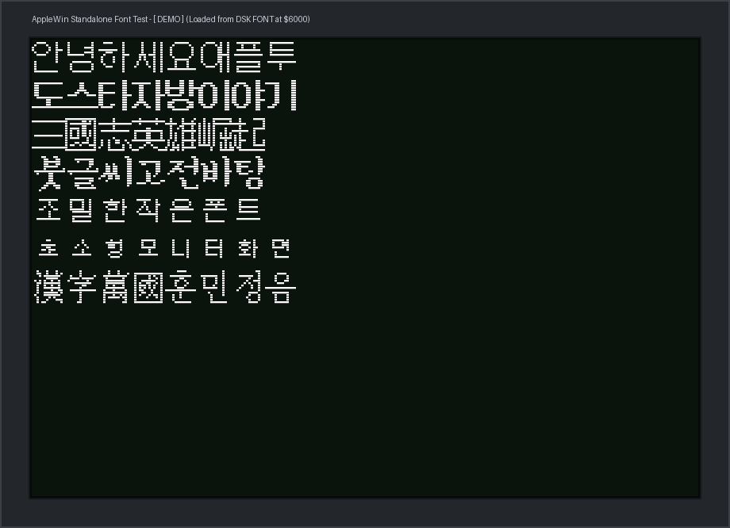

### 폰트 미리보기 및 비교 (`tools/preview_fonts.py`)

모든 폰트를 터미널 ASCII 형태와 고해상도 비교 이미지로 나란히 그려 비교합니다:

```bash
python tools/preview_fonts.py
# 비교 이미지를 docs/images/font_comparison.png로 저장
```

---

## 🎨 실전 다중 폰트 활용 가이드

이 절은 Apple II 게임, 유틸리티, 소프트웨어에서 **여러 폰트를 효과적으로 조합하고 바꾸어 쓰는 방법**을 실제 Applesoft BASIC 예제와 함께 보여 줍니다.

### 1. 원하는 TTF 폰트 가져오기
번들 예제 폰트 말고도 원하는 TrueType 또는 OpenType 폰트(`.ttf`, `.otf`)를 쓸 수 있습니다:
1. `.ttf` 파일을 `fonts/` 폴더에 넣습니다(또는 절대/상대 경로를 씁니다).
2. BASIC 프로그램이나 서버 실행 옵션에서 `/font-add`로 등록합니다:
   ```basic
   10 & "/font-add 1 NanumGothic.ttf"
   20 & "/font-add myfont C:\Windows\Fonts\batang.ttc"
   ```

---

### 2. 실전 활용 예와 Applesoft BASIC 코드

#### 시나리오 A: 고전 RPG 대화창 (여러 폰트 조합)
게임 제목, 등장인물 이름, 대사, 상태창(HUD)에 각각 전용 폰트를 써서 화면의 격을 높입니다:
* **제목 / 장소**: 웅장한 고전 한자·한글 삼국지3 폰트 (`[F:title]`)
* **화자 이름**: 붓글씨 느낌의 우아한 도스명조 (`[F:speaker]`)
* **대사**: 읽기 좋은 14px 픽셀 폰트 Galmuri14 (`[F:body]`)
* **상태창 / HUD**: 작은 9px 마이크로 픽셀 폰트 Galmuri9 (`[F:hud]`)

```basic
10 REM ====================================================
20 REM  Classic RPG Multi-Font Dialogue Window Example
30 REM ====================================================
40 & "/font-add title Sam3KRFont.ttf"
50 & "/font-add speaker DOSMyungjo.ttf"
60 & "/font-add body Galmuri14.ttf"
70 & "/font-add hud Galmuri9.ttf"
80 & "/clear"
90 & "[F:title]\K[ 長安城 皇宮 ]\N"
100 & ""
110 & "[F:speaker]\K제갈공명(諸葛孔明):\N"
120 & "[F:body]\K주공, 동남풍(東南風)이 불기 시작했습니다.\N"
130 & "[F:body]\K지금 즉시 화공(火攻)을 명하셔야 합니다!\N"
140 & ""
150 & "[F:hud]\KHP: 950/950  MP: 320/320  GOLD: 12500 G  TURN: 42\N"
160 END
```

#### 시나리오 B: 인라인 태그로 문장 속 키워드 강조
`[F:슬롯]` 인라인 태그를 쓰면 줄을 바꾸지 않고 문장 중간에서 폰트를 바꿀 수 있습니다:
```basic
10 & "[F:body]\KThe hero obtained \N[F:title]\K傳說의 寶劍\N[F:body]\K!\N"
20 & "[F:neodgm]\KStandard dialogue text \N[F:speaker]\K[IMPORTANT NOTICE]\N[F:neodgm]\K returns to normal.\N"
```

#### 시나리오 C: 장면 전환 때 폰트 슬롯 재사용 (메모리 절약)
게임 장(章)이 바뀔 때 기존 폰트 슬롯을 다른 폰트로 바꿔 메모리를 아낍니다:
```basic
100 REM [Town Scene] - Map Slot 1 to peaceful Gothic font
110 & "/font-add 1 DOSGothic.ttf"
120 & "[F:1]\KWelcome to the village tavern.\N"
...
200 REM [Dungeon Scene] - Reassign Slot 1 to dramatic Myeongjo!
210 & "/font-add 1 DOSMyungjo.ttf"
220 & "[F:1]\KA dark iron gate creaks open in the subterranean dungeon...\N"
```

---

### 3. 플로피(DSK)에 여러 폰트 저장 및 오프라인 실행

> **Q. 프로그램에서 여러 폰트를 쓰면, PC 시리얼 연결 없이 실제 Apple II에서 단독으로 돌릴 수 있나요?**  
> **A. 네, 완벽하게 됩니다!**

여러 폰트를 쓰는 프로그램도 플로피 디스크 이미지에 그대로 넣을 수 있습니다:

1. **명령 한 줄로 서브셋 생성 및 패키징**:
   ```bash
   python build_font_dsk.py --dsk unicode.dsk
   ```
2. **동작 원리 (여러 폰트 자동 서브셋)**:
   - `build_font_dsk.py`가 BASIC 프로그램을 훑으며 모든 `/font-add`, `/font-del`, `[F:...]` 태그를 따라갑니다.
   - 글자마다 해당 폰트 엔진으로 그립니다(예: `[F:title]`이 붙은 글자는 `Sam3KRFont.ttf`, `[F:body]`가 붙은 글자는 `Galmuri14.ttf`).
   - 뽑아낸 14×16 글리프 비트맵을 하나의 작은 `$6000` 바이너리(`FONT`)로 합쳐 DSK 이미지에 넣습니다.
   - 디스크의 `HELLO` 부팅 스크립트에 `BLOAD FONT`를 자동으로 추가합니다.
3. **결과**:
   - AppleWin이나 실제 Apple II 디스크 드라이브에 `unicode.dsk`를 넣고 부팅한 뒤 `RUN 프로그램이름`을 입력합니다.
   - 지정한 모든 폰트가 **PC나 시리얼 연결 없이** Apple II 로컬 RAM에서 하드웨어 속도로 정확하게 그려집니다!

---

### 4. 여러 폰트 명령·문법 요약표

| 명령 / 태그 | 사용 예 | 설명 |
| :--- | :--- | :--- |
| **`/font-add` (번호)** | `& "/font-add 1 neodgm.ttf"` | 슬롯 1에 폰트 지정 (이미 있으면 변경) |
| **`/font-add` (별칭)** | `& "/font-add title Sam3KRFont.ttf"` | 원하는 별칭(`title`, `body`, `hud` 등)에 폰트 지정 |
| **`/font-del`** | `& "/font-del title"` | 슬롯이나 별칭 해제 (`/unalias`도 지원) |
| **`/font-clear`** | `& "/font-clear"` | 등록한 폰트 슬롯 모두 초기화 |
| **`/font`** | `& "/font 1"` 또는 `& "/font body"` | 이후 줄의 기본 폰트 변경 |
| **`[F:...]` (인라인)** | `& "[F:1]Hangul [F:title]Hanja"` | 문자열 안 어디서든 폰트 전환 |
| **`\F...\` (인라인)** | `& "\F1\Hangul \F:title\Hanja"` | 백슬래시로 쓰는 대체 문법 |
| **`--font` (서버 옵션)** | `--font "1=neodgm.ttf, title=Sam3KRFont.ttf"` | 서버 시작 시 슬롯 미리 등록 |
| **폴백 체인** | `--font "Galmuri14.ttf, Sam3KRFont.ttf"` | 글리프가 없으면 다음 폰트에서 자동 검색 |

---

## 🌈 Apple II HGR 컬러 지원 및 드로잉 모드 (Overlay / Replace / XOR)

Apple II 고해상도 그래픽(280×192)의 표현력을 살려 **글자에 색을 입히고**, 배경을 지우지 않고 **기존 그래픽 위에 겹쳐 그릴 수** 있습니다!

### 1. Apple II HGR 컬러 시스템

Apple II는 컬러 컴포지트 모니터에서 아티팩트 컬러(NTSC 색 부반송파 위상)로 색을 만듭니다. 픽셀이 짝수 열인지 홀수 열인지와 바이트의 최상위 비트(팔레트 비트 `$80`)가 색을 정합니다. 브리지 드라이버와 서버가 열에 따른 비트 패턴 변환($2A, $55, $D5, $AA)을 자동으로 처리하므로, 색은 이름이나 번호만 지정하면 됩니다:

| 색 번호 | 이름 (대소문자 무관) | 별칭 | 팔레트 및 특징 |
| :---: | :--- | :--- | :--- |
| **0** (또는 4) | **`black`** | `bk` | 검은색 (팔레트 0 / 1) |
| **1** | **`green`** | `g` | 녹색 (팔레트 0, 비트 7 = 0) |
| **2** | **`violet`** | `purple`, `p`, `v` | 보라색 (팔레트 0, 비트 7 = 0) |
| **3** (또는 7) | **`white`** | `w` | 흰색 (팔레트 0 / 1, 모든 비트 켬) |
| **5** | **`orange`** | `red`, `o`, `r` | 주황색 (팔레트 1, 비트 7 = 1) |
| **6** | **`blue`** | `cyan`, `b`, `c` | 파란색 (팔레트 1, 비트 7 = 1) |

*Applesoft BASIC의 `HCOLOR=x` 명령도 `&` 명령을 실행할 때마다 자동으로 반영됩니다.*

**컬러 글자를 그리는 방식**: HGR의 컬러 점은 한 칸 건너 하나씩만 찍힙니다(이웃한 두 점은 흰색). 그래서 14점 폭 한 칸에 컬러 점은 가로 7개뿐이고, 흰색용 14점 글리프를 반으로 접던 예전 방식은 획이 겹치거나 끊겼습니다. 이제 서버는 컬러 글자를 처음부터 7칸에 맞춰 벡터 글꼴로 8×15 크기로 그리고(기본 맑은 고딕, 없으면 시스템 CJK 글꼴, `--color-font`로 지정 가능), 칸마다 그 색의 위상에 컬러 점 하나를 찍습니다. 흰색 글자는 14점 글리프를 그대로 씁니다. 컬러 글꼴에 없는 글자와 옛한글 음절은 예전 방식으로 그립니다.

같은 `[C:...]` 줄을 예전 방식(위)과 새 방식(아래)으로 그려 에뮬레이트된 Apple //e의 LCD에서 캡처했습니다(STM32F769I-DISCO, 컬러 점을 점 하나 폭으로 보여 주는 픽셀 단위 디코딩. 컴포지트 모니터나 AppleWin의 Color TV 모드는 점을 옆으로 번지게 보여 주어 가로 획이 이어져 보입니다):

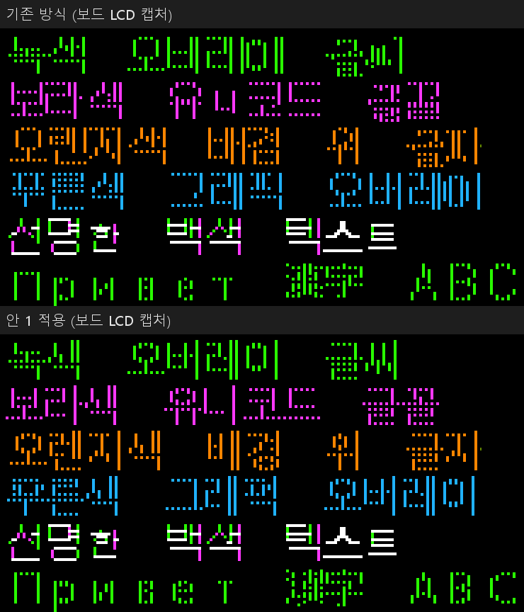

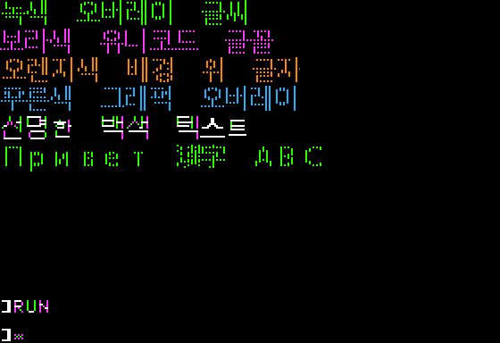

---

### 2. 드로잉 모드 (Replace vs Overlay vs XOR)

| 드로잉 모드 | 번호 | 6502 연산 | 동작 및 용도 |
| :--- | :---: | :---: | :--- |
| **`replace`** | `0` | `STA` | **기본값**. 글리프를 그리기 전에 14×16 글자 칸을 검은색으로 지웁니다. 가장 선명하게 읽힙니다. |
| **`overlay`** | `1` | `ORA` | **배경 그래픽 보존**. 격자, 도표, 지도, 게임 배경 등을 지우지 않고 글자 획만 HGR 화면에 OR로 겹쳐 그립니다. |
| **`xor`** | `2` | `EOR` | **배경 픽셀 반전**. 글자 비트맵을 아래 화면 픽셀과 XOR합니다. 반전 선택 커서나 강조 표시에 알맞습니다. 색 영역 위에 그 영역과 같은 색으로 XOR하면 검은 글자가 새겨집니다. |

overlay와 XOR 모드에서는 글자 점이 하나도 없는 바이트는 팔레트 비트까지 그대로 두고, 글자가 그려지는 바이트는 글자의 팔레트 비트를 배경의 것과 OR합니다. 그래서 주황·파랑 배경 위의 흰 글자는 배경 색을 유지하고, 검은 바탕의 주황·파랑 글자도 제 색을 유지합니다.

> [!TIP]
> 색이 칠해진 영역 위에 흰 글자를 overlay하면 점의 절반 가량이 묻힙니다(색 영역은 이미 점이 하나 건너 하나씩 켜져 있음). 색 영역 위의 글자는 그 영역과 같은 색으로 XOR해 검은 글자로 새기거나, `replace`로 칸을 지운 뒤 쓰십시오.

---

### 3. 명령 문법 및 인라인 스타일 태그

#### (1) 전역 슬래시 명령
줄 전체의 그리기 속성을 정합니다:
```basic
10 & "/color green"      : REM 글자 색 지정 (green, violet, white, orange, blue, 0~7)
20 & "/mode overlay"      : REM 드로잉 모드를 overlay로 (overlay, replace, xor, 0, 1, 2)
30 & "/overlay"           : REM /mode overlay 단축 명령
40 & "/replace"           : REM /mode replace 단축 명령
50 & "/xor"               : REM /mode xor 단축 명령
60 & "/pos 2 5"           : REM 커서를 2열(28px), 5행(80px)으로 이동
70 & "/clear"             : REM HGR 화면을 지우고 커서를 (0,0)으로
```

#### (2) 인라인 스타일 태그
줄을 바꾸지 않고 문장 중간에서 색이나 드로잉 모드를 바꿉니다:
* **색 태그**: `[C:green]`, `[C:orange]`, `[C:blue]`, `[C:violet]`, `[C:white]`, `[COLOR:1]`, `\C:1\`
* **모드 태그**: `[M:overlay]`, `[M:replace]`, `[M:xor]`, `[MODE:1]`, `\M:overlay\`

```basic
10 & "[C:orange][M:overlay]\KWARNING!\N [C:green]System online.\N"
20 & "[C:white]\KClear box: \N[M:replace][C:blue]\KThis text clears background\N"
```

---

### 4. 실제 동작 화면: `RUN COLORDEMO`

`unicode.dsk`에 들어 있는 `COLORDEMO` 프로그램(`tools/create_color_overlay_demo.py`로 생성)은 네 가지 색 띠를 그리고, 각 띠에 그 띠와 같은 색으로 XOR해 검은 글자를 새깁니다. 띠마다 글꼴이 다르고, 마지막 두 줄은 검은 바탕에 replace 모드로 흰 글자를 씁니다(아래는 글자를 풀어 쓴 것이고, 프로그램에는 `\K...\N` 16진수로 들어 있습니다):

```basic
10 REM *** GORGEOUS APPLE II MULTI-COLOR DEMO ***
20 HGR : HCOLOR=6: FOR Y=0 TO 17: HPLOT 0,Y TO 279,Y: NEXT Y
30 & "/pos 1 0" : & "/xor" : & "[F:sam3k][C:blue]★ 애플 II 멀티폰트 데모 ★"
40 HCOLOR=1: FOR Y=32 TO 49: HPLOT 0,Y TO 279,Y: NEXT Y
50 & "/pos 1 2" : & "/xor" : & "[F:neodgm][C:green]녹색 리본: 둥근모 레트로 타자체"
60 HCOLOR=5: FOR Y=64 TO 81: HPLOT 0,Y TO 279,Y: NEXT Y
70 & "/pos 1 4" : & "/xor" : & "[F:dosmyungjo][C:orange]주황 리본: 품격있는 도스명조체"
80 HCOLOR=2: FOR Y=96 TO 113: HPLOT 0,Y TO 279,Y: NEXT Y
90 & "/pos 1 6" : & "/xor" : & "[F:galmuri14][C:violet]보라 리본: 선명한 갈무리 본문체"
100 & "/pos 1 8"  : & "/replace" : & "[F:galmuri11][C:white]블랙 바탕: 갈무리11 폰트"
110 & "/pos 1 9"  : & "/replace" : & "[F:galmuri9][C:white]HUD: 초소형 갈무리9 폰트"
120 END
```

디스크의 `$6000` 글꼴 캐시로 단독 실행한 화면(6502 드라이버가 14점 글리프를 직접 색 점으로 접고, ASCII 글자는 건너뜀):

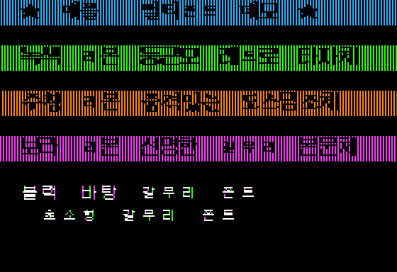

PC 서버가 글리프를 보내는 화면(`POKE 24576,0`으로 캐시를 끈 뒤 실행, 컬러 글자를 가로 7칸에 맞춰 그림):

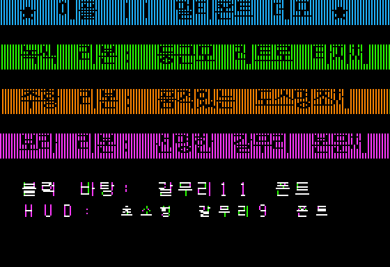

*둘 다 에뮬레이트된 Apple //e의 LCD(STM32F769I-DISCO, 컬러 점을 점 하나 폭으로 보여 주는 픽셀 단위 디코딩이라 띠가 줄무늬로 보임, 컴포지트 모니터에서는 꽉 찬 색)에서 캡처했습니다.*

---

## 🎧 ADTPro 오디오 / 카세트 전송 (시리얼 카드 없이)

Super Serial Card 같은 직렬 통신 카드가 없는 순정 Apple II/IIe에서도, **PC의 3.5mm 오디오 출력(이어폰/스피커 단자)과 Apple II 뒷면의 Cassette IN 단자**를 케이블로 연결하기만 하면 폰트 데이터를 실시간으로 받을 수 있습니다.

> [!IMPORTANT]
> **AppleWin 제약 (실기 전용 기능)**:
> AppleWin은 PC 사운드카드 입력(마이크/라인인)을 Apple II 카세트 포트(`$C060 TAPEIN`)로 전달하는 기능을 에뮬레이트하지 않습니다(`Tape.cpp: TapeRead`는 항상 부동 버스 값을 돌려줌).
> 따라서 이 오디오 전송은 실제 Apple II를 3.5mm 오디오 케이블로 PC와 뒷면 Cassette IN 단자에 연결해 쓰는 **실기 전용 기능**입니다. AppleWin에서는 **시리얼(TCP/COM 포트) 연결**이나 **독립형 DSK 폰트 캐시(`$6000`)** 를 쓰십시오.

### 1. 전송 규격 (ADTPro Audio FSK Modulation)
검증된 ADTPro(`BytesToWav.java`, `AudioTransport.java`)의 오디오 프로토콜을 씁니다:
- **오디오 형식**: 44.1 kHz, 8비트 unsigned PCM (.WAV)
- **리더 톤**: 770 Hz 사인파
- **싱크 비트**: 2200 Hz
- **데이터 비트 '0'**: 2000 Hz 반주기 (~250 µs)
- **데이터 비트 '1'**: 1000 Hz 반주기 (~500 µs)
- **체크섬과 트레일러**: Running XOR 체크섬 바이트 + 200 Hz 트레일러 + 무음 구간

### 2. PC 쪽 폰트 오디오 스트리밍 도구
DSK 이미지의 폰트 데이터를 오디오 파형으로 바꿔 PC 스피커나 이어폰 단자로 내보냅니다:
```bash
# 1) DSK 폰트 캐시를 WAV로 만들어 PC 사운드카드로 바로 재생
python tools/audio_font_streamer.py --dsk unicode.dsk --play

# 2) 또는 WAV 파일로만 저장
python tools/audio_font_streamer.py --dsk unicode.dsk --wav my_font.wav

# 3) unicode_server가 직접 폰트 오디오 스트림 생성
python unicode_server.py --audio-wav font_stream.wav
```

### 3. Apple II 드라이버의 수신 모드 전환
6502 드라이버는 `$C060`(TAPEIN)의 0↔1 전환 사이 주기를 재어 오디오 신호를 실시간으로 해독합니다:
- **오디오 모드로 전환**:
  ```basic
  & "/audio"     (또는 & "/aud")
  ```
- **시리얼(Super Serial) 모드로 복귀**:
  ```basic
  & "/serial"    (또는 & "/ser")
  ```

---

## 🤝 기여하기

`apple2-unicode-bridge`에 대한 기여를 환영합니다! 관심 있는 분야:
- ProDOS와 80열 더블 하이레스(DHGR 560×192) 모드용 6502 드라이버 추가.
- PC 쪽에서 양방향 텍스트(아랍어, 히브리어) 셰이핑 엔진 지원.
- 6502와 시리얼을 갖춘 다른 레트로 기종용 디스크 이미지.

이슈를 열거나 Pull Request를 보내 주세요!

---

## 📄 라이선스

- **소스 코드 및 문서**: [MIT License](LICENSE). Copyright (c) 2026 mildstorm.
- **번들 폰트**:
  - `Galmuri` 시리즈 (`Galmuri14.ttf`, `Galmuri11.ttf`, `Galmuri9.ttf`): [SIL Open Font License 1.1](fonts/README.md) by quiple.
  - `Neo둥근모` (`neodgm.ttf`): [SIL Open Font License 1.1](fonts/README.md) by Dalgona.
  - `Sam3KRFont.ttf`, `DOSGothic.ttf`, `DOSMyungjo.ttf`: [MIT License](fonts/README.md) by Damheo Lee.
  - `NotoSerifCJK16.ttf`: [SIL Open Font License 1.1](https://scripts.sil.org/OFL) by Google / Adobe.

> 💡 **개발자 참고**: 전체 동작 자동 회귀 테스트는 `python tools/test_all_operations.py`로 실행할 수 있습니다.
