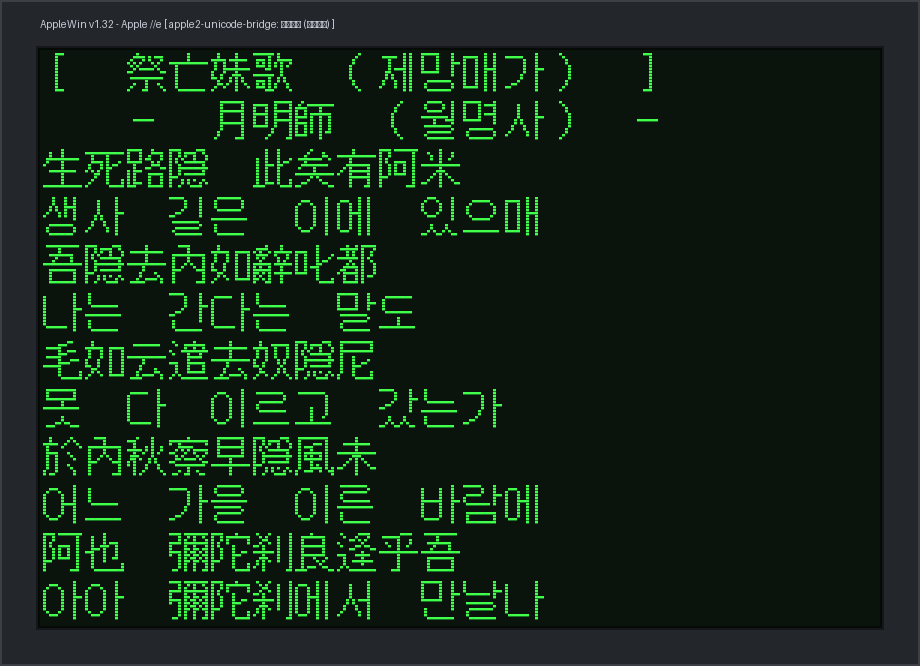
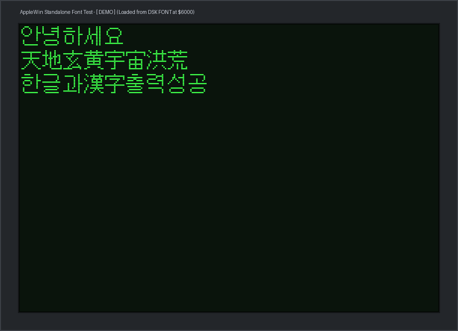

# Apple II Unicode Bridge (`apple2-unicode-bridge`)

[English Documentation](README.md) | [한국어 문서](README_HANGUL.md)

AppleWin 또는 실물 Apple II의 C++ 소스 코드 및 롬(ROM)을 전혀 수정하지 않고, 표준 **Super Serial Card (SSC, Slot 2)** 통신을 통해 PC에서 FreeType / TrueType 폰트를 래스터라이징하여 Apple II 고해상도 그래픽(HGR 280x192) 화면에 **한글 11,172자, 漢字(한자), CJK 및 전 세계 유니코드 다국어 문자**를 출력하고, Applesoft BASIC 프로그램 작성 및 대화형 입력을 지원하는 유니코드 폰트 브리지 시스템입니다.

---

## 📺 실제 동작 화면: 祭亡妹歌 (제망매가) 한자 및 한글 혼용 출력

신라 향가 월명사의 *제망매가(祭亡妹歌)* 원문(한자/향찰)과 한글 풀이를 Apple II 고해상도 그래픽(HGR 280×192) 화면에 동적으로 렌더링한 실제 화면입니다:



### Applesoft BASIC 프로그램 예제

Applesoft BASIC 프롬프트에서 `&` 명령어를 사용하여 한글과 한자를 손쉽게 출력할 수 있습니다:

```basic
10 REM ====================================================
20 REM  祭亡妹歌 (제망매가) - 月明師 (월명사)
30 REM  Apple II HGR 한자 및 한글 출력 데모
40 REM ====================================================
50 & "\K[ 祭亡妹歌 (제망매가) ]\N"
60 & "\K  - 月明師 (월명사) -\N"
70 & "\K生死路隱 此矣有阿米\N"
80 & "\K생사 길은 이에 있으매\N"
90 & "\K吾隱去內如辭叱都\N"
100 & "\K나는 간다는 말도\N"
110 & "\K毛如云遣去奴隱尼\N"
120 & "\K못 다 이르고 갔는가\N"
130 & "\K於內秋察早隱風未\N"
140 & "\K어느 가을 이른 바람에\N"
150 & "\K阿也 彌陀刹良逢乎吾\N"
160 & "\K아아 彌陀刹에서 만날나\N"
```

#### AppleWin에서 한글/한자 입력 방법:
1. AppleWin에서 `50 & "` 까지 타이핑합니다.
2. **`Ctrl+K`** 키를 누릅니다.
3. PC 화면에 나타나는 팝업 또는 콘솔 입력창에 `[ 祭亡妹歌 (제망매가) ]`를 입력하고 `Enter`를 누릅니다.
4. Apple II에 안전한 헥사 인코딩(`\K...\N`) 문자열이 자동 입력됩니다.
5. 끝에 따옴표(`"`)를 닫고 `Enter`를 칩니다.
6. `RUN`을 입력하면 화면이 HGR 그래픽으로 전환되며 고품질 글리프가 출력됩니다.

---

## 1. 주요 특징 및 해결된 핵심 원리

1. **Applesoft BASIC `&` (Ampersand) 문을 통한 한글/한자 출력**:
   - Apple II의 기본 40열 TEXT 화면은 하드웨어 문자 생성 롬(ROM)이 영문 전용(7비트 ASCII)이므로 한글 및 한자 글리프를 표시할 수 없습니다.
   - 따라서 모든 한글 및 한자는 고해상도 그래픽(HGR, 280x192) 화면에 14x16 픽셀 트루타입 폰트로 렌더링됩니다.
   - BASIC 프로그램 내에서 `10 & "\K한글과 漢字\N"` 형태로 문장을 작성하고 `RUN`하면 자동으로 HGR 화면으로 전환되어 아름다운 고품질 글꼴로 출력됩니다.

2. **BASIC 작성 중 특수키(`Ctrl+K`)를 통한 콘솔 직접 한글 / 漢字 입력**:
   - AppleWin 에뮬레이터에서 BASIC 코드를 작성하다가 한글이나 한자를 입력해야 할 때 **`Ctrl+K`** 키를 누릅니다.
   - `hangul_server` 콘솔 창에 `한글/漢字 입력 > ` 프롬프트가 나타나며, 콘솔창에서 바로 한글/한자를 타이핑하거나 복사한 긴 한자 텍스트를 붙여넣고 `Enter`를 누르면 Apple II의 현재 입력 행으로 자동 전달됩니다. (GUI 팝업을 원할 경우 `--popup` 옵션 제공)

3. **Caps Lock 및 BASIC 파서 충돌 방지 (Hex 안전 인코딩)**:
   - Apple II 키보드 루틴(`GETLN`) 및 Applesoft 파서(`PARSE`)는 8비트 코드를 BASIC 키워드 토큰($80~$EA)이나 줄바꿈/취소 제어문자($80~$9F)로 오인하여 `?SYNTAX ERROR`를 발생시켰습니다.
   - 본 시스템은 `Ctrl+K` 입력 시 안전한 Hex 기반 인코딩(`\K...\N`)으로 전달하여, 따옴표(`"`) 충돌, 제어문자 오작동, Caps Lock 대소문자 변환 문제 없이 100% 안전하게 저장하고 실행합니다.

4. **대화형 전체화면 터미널 모드**:
   - BASIC 프롬프트 `]`에서 단순 `&` 입력 후 Enter를 치면 전체화면 한글/한자 터미널 모드로 진입합니다.
   - 2벌식 실시간 자소 조합 타이핑(`Ctrl+K` 또는 `` ` `` 키로 한/영 전환)을 지원하며, `ESC` 키로 BASIC으로 복귀합니다.

---

## 2. 생성 및 구성 파일

- [`unicode.dsk`](unicode.dsk): 부팅 가능한 통합 DOS 3.3 디스크 이미지 (`UNICODE.BIN` 드라이버, 독립 실행용 `FONT` 파일 및 `DEMO`/`JEMANG` 프로그램 탑재).
- [`ac_tool.py`](ac_tool.py): AppleCommander 연동 및 DSK 디스크 관리 표준 유틸리티 모듈 & CLI 도구.
- [`build_font_dsk.py`](build_font_dsk.py): BASIC 프로그램에서 사용된 글자만 추출하여 DSK 내 `FONT` 파일로 자동 베이킹하는 서브셋 빌더.
- [`inject_basic.py`](inject_basic.py): PC에서 한글 BASIC 프로그램을 입력/주입하고 폰트 서브셋을 자동 동기화하는 도구.
- [`verify_dsk_font.py`](verify_dsk_font.py): DSK 내 `FONT` 바이너리를 역추출하여 렌더링 무결성을 검증하는 도구.
- `unicode_server.exe`: 독립 실행 가능한 단일 PC 서버 실행 파일 (`NotoSerifCJK16.ttf` 폰트 내장, Releases 릴리스 탭 제공).
- [`unicode_server.py`](unicode_server.py): PC 측 범용 유니코드 통신/폰트 서버 소스 코드.
- [`unicode_driver.s`](unicode_driver.s): 6502 어셈블리 드라이버 소스.
- [`UNICODE.BIN`](UNICODE.BIN): Apple II 상주 바이너리 드라이버 ($4000).

---

## 3. 환경 설정 및 필수 도구 가이드 (Environment Setup)

누구나 아래 절차에 따라 간편하게 개발 및 디스크 제작 환경을 구축할 수 있습니다. **스크립트에는 일체의 개인 경로가 포함되어 있지 않으며**, 표준 환경 변수 및 상대 경로 자동 탐색을 지원합니다.

### 3.1 필수 요구사항
1. **Python 3.8 이상**:
   - 필수 패키지 설치:
     ```bash
     pip install pillow freetype-py
     ```
2. **Java 런타임 (JRE / JDK 8 이상)**:
   - AppleCommander 실행을 위해 Java가 필요합니다. 터미널에서 `java -version`을 입력하여 설치 여부를 확인하세요.

### 3.2 AppleCommander 설정 (3가지 방법 중 택 1)
디스크(.dsk) 파일 주입 및 추출을 담당하는 AppleCommander는 다음 3가지 방법 중 하나로 자유롭게 구성할 수 있습니다:

- **방법 1 (가장 간단 - 기본 제공)**:
  - 본 저장소의 [`tools/`](tools/) 폴더에 `AppleCommander.jar`가 기본 배치되어 있습니다. 따라서 별도의 환경설정 없이도 `build_font_dsk.py`, `inject_basic.py`, `verify_dsk_font.py` 등의 모든 스크립트가 자동으로 도구를 감지하여 실행됩니다.
- **방법 2 (시스템 환경 변수 등록 - 권장)**:
  - 이미 PC의 다른 위치에 AppleCommander가 있거나 전역으로 관리하고 싶다면 환경 변수를 등록합니다:
    - **Windows (PowerShell)**:
      ```powershell
      [System.Environment]::SetEnvironmentVariable('APPLECOMMANDER_JAR', 'C:\경로\AppleCommander.jar', 'User')
      ```
    - **Linux / macOS (`~/.bashrc` 또는 `~/.zshrc`)**:
      ```bash
      export APPLECOMMANDER_JAR="/usr/local/bin/AppleCommander.jar"
      ```
- **방법 3 (실행 시 직접 옵션 전달)**:
  - 각 스크립트 실행 시 `--ac-jar` 옵션으로 JAR 파일 경로를 명시합니다:
    ```bash
    python build_font_dsk.py --dsk unicode.dsk --ac-jar "C:\tools\AppleCommander.jar"
    ```

### 3.3 원클릭 환경설정 자동 진단 (`ac_tool.py`)
아래 명령어를 실행하면 Java 설치 여부와 AppleCommander 설정 상태가 올바른지 한눈에 확인할 수 있습니다:

```bash
python ac_tool.py check
```

---

## 4. 사용 방법 (실시간 PC 폰트 서버 스트리밍)

### 1단계: PC 서버 실행
명령 프롬프트 또는 파워셸에서 `unicode_server.exe` (또는 `python unicode_server.py`)를 실행합니다:
```bash
./unicode_server.exe
```

### 2단계: AppleWin 실행 및 디스크 부팅
1. `Release\AppleWin.exe`를 실행합니다. (Slot 2 SSC는 TCP 포트 1977로 자동 구성되어 있습니다.)
2. 드라이브 1에 `unicode.dsk`를 넣고 부팅(F2)합니다.
3. 부팅 안내 화면과 함께 `]` 프롬프트가 나타납니다.

---

## 5. 독립 실행형(Standalone / 오프라인) 폰트 서브셋 빌더 및 폰트 재사용

PC 폰트 서버(Super Serial 연결) 없이 **Apple II 단독으로 DSK 디스크만 부팅하여 한글/한자를 출력**하고 싶을 때 사용합니다. 프로그램 문장에 실제로 사용된 글리프(14×16 비트맵)만 추출하여 디스크 내에 `FONT` ($6000) 파일로 저장(Baking)합니다.

### 5.1 폰트 서브셋(경량화) 재사용 원리
- **140KB 디스크 용량 한계 극복**: 유니코드 한글 11,172자(약 357KB)나 수만 자의 漢字를 140KB 플로피 디스크에 전부 담는 것은 불가능합니다.
- **문장 사용 글자만 추출**: 예를 들어 *제망매가*와 `DEMO` 전체에 사용된 서로 다른 77자의 한글과 漢字 글꼴만 추출하면 **단 2.7 KB** (디스크 섹터 단 12개)에 불과합니다.
- **메모리 상주 및 고속 렌더링**: 부팅 시 `HELLO` 프로그램이 `BLOAD FONT`를 실행하여 `$6000` 메모리에 폰트 테이블을 상주시키며, 드라이버가 통신 대기 없이 로컬 메모리에서 즉시 고속으로 HGR 화면에 글자를 렌더링합니다.

### 5.2 폰트 서브셋 빌드 및 디스크 주입 명령어
새로운 한글/한자 BASIC 프로그램을 작성하거나 기존 프로그램을 수정한 후 아래 명령을 실행합니다:

```bash
# unicode.dsk 내의 모든 BASIC 프로그램을 스캔하여 FONT 파일 자동 생성 및 주입
python build_font_dsk.py --dsk unicode.dsk

# 특정 BASIC 프로그램(예: DEMO, JEMANG)만 지정하여 폰트 추출
python build_font_dsk.py --dsk unicode.dsk --programs DEMO,JEMANG
```

- **동작 단계**:
  1. DSK 내의 BASIC 프로그램(`DEMO`, `JEMANG` 등)을 스캔하여 사용된 유니코드 한글/한자를 자동 추출합니다.
  2. PC의 고품질 TrueType 글꼴을 통해 해당 글자들만의 14×16 비트맵 테이블(`FONT`, 2~3KB)을 생성합니다.
  3. `AppleCommander`를 통해 DSK에 `FONT` 바이너리($6000)로 주입하고 `HELLO` 부팅 스크립트에 `BLOAD FONT`를 추가합니다.
  4. 부팅 시 폰트가 메모리(`$6000`)에 상주하므로, PC 폰트 서버 연결 없이도 `RUN DEMO`나 `RUN JEMANG`을 즉시 독립 실행할 수 있습니다.

### 5.3 BASIC 프로그램 작성 도구 (`inject_basic.py`) 연동
PC에서 새 BASIC 프로그램을 작성하여 디스크에 넣을 때, `inject_basic.py`를 사용하면 프로그램 주입과 동시에 폰트 서브셋도 DSK의 `FONT` 파일에 자동으로 갱신됩니다:

```bash
python inject_basic.py
```

### 5.4 폰트 바이너리 렌더링 무결성 검증 (`verify_dsk_font.py`)
DSK 디스크 이미지에 주입된 `FONT` 바이너리 데이터를 직접 역추출하여 글리프가 왜곡이나 깨짐 없이 정상 렌더링되는지 검증할 수 있습니다:

```bash
python verify_dsk_font.py
```
- 실행 시 DSK 내 `FONT` 바이너리를 직접 읽어 `verified_standalone_jemang.png` 및 `verified_standalone_demo.png` 화면 캡처 이미지를 생성합니다.

---

## 6. 검증된 동작 테스트

### 테스트 A: 한글 및 漢字(한자) 내장 데모 실행
Apple II BASIC 프롬프트에서 다음을 입력합니다:
```basic
RUN DEMO
```
- 화면이 즉시 HGR 고해상도 그래픽 모드로 전환되며:
  1. `안녕하세요 Apple II!`
  2. `天地玄黃 宇宙洪荒`
  3. `한글과 漢字 출력 성공!`
  4. `1977 - 2026 RETRO COMPUTING`
  문장이 고품질 글리프로 깨끗하게 출력됩니다.

### 테스트 B: 사용자가 직접 BASIC 프로그램 입력
1. AppleWin에서 다음과 같이 타이핑합니다:
   ```basic
   10 & "
   ```
2. 여기서 **`Ctrl+K`** 키를 누릅니다.
3. PC 팝업창이 나타납니다. 한글이나 한자를 입력하고 Enter를 누릅니다:
   - 예: `안녕 漢字`
4. 따옴표와 Enter를 입력하여 행을 완성합니다:
   ```basic
   "
   ```
5. `RUN`을 입력하여 실행하면 HGR 화면에 한글과 한자가 완벽하게 출력됩니다.

### 테스트 C: 대화형 터미널 모드
BASIC 프롬프트 `]`에서 `&`만 입력하고 Enter를 누르면 전체화면 한글 그래픽 콘솔 모드로 진입합니다:
- `Ctrl+K` 또는 `` ` `` 키: 한글 2벌식 / 영문 전환
- `ESC` 키: BASIC 프롬프트로 복귀

---

## 7. 지원 폰트 라이브러리 및 폰트 엔진 옵션

`apple2-unicode-bridge`는 애플 II의 14×16 고해상도(HGR) 픽셀 환경에 맞춰 **벡터 외곽선 폰트**와 **레트로 비트맵/픽셀 폰트**를 모두 완벽하게 지원합니다:

* **픽셀 / 비트맵 TTF (레트로 도스/고전 감성 추천)**:  
  **갈무리(Galmuri)**, **Neo둥근모**, **삼국지3 폰트** 등 정수 픽셀 단위로 디자인된 폰트입니다. 1비트 흑백 환경에서도 획 뭉개짐이나 글자 깨짐 없이 칼같이 선명한 레트로 출력을 보여줍니다.
* **벡터 외곽선 TTF (전 세계 범용 다국어 지원)**:  
  **Noto Serif CJK** 등 수만 자의 한글/한자/일본어/키릴/그리스/확장 라틴 문자를 포괄하는 범용 폰트입니다.
* **임베디드 비트맵 (`EBDT`) 자동 활용**:  
  Windows 기본 **굴림체(`gulim.ttc`)**의 경우, 14px 구간에 내장된 1비트 흑백 비트맵을 자동으로 불러와 최상의 한글/한자 품질을 제공합니다.

### 7.1 번들 폰트 목록 (`fonts/` 디렉터리)

프로젝트에 포함된 모든 폰트는 상업적/비상업적으로 무료 사용 가능한 오픈소스 라이선스(SIL OFL 또는 MIT)를 따릅니다.

| 폰트 파일 | 형태 | 디자인 규격 | 특징 및 권장 용도 | 라이선스 | 출처 |
| :--- | :--- | :--- | :--- | :--- | :--- |
| **`Galmuri14.ttf`** | 픽셀 TTF | 14×14 | **애플 II HGR 기본 권장 폰트.** 상하 1줄 패딩(`--y-offset 1`)을 주면 14×16 격자에 가장 완벽하게 안착함. | SIL OFL 1.1 | [quiple/galmuri](https://github.com/quiple/galmuri) |
| **`Galmuri11.ttf`** | 픽셀 TTF | 11×11 | 작은 픽셀 폰트. 조밀한 텍스트 배치나 80컬럼 모드에 적합. | SIL OFL 1.1 | [quiple/galmuri](https://github.com/quiple/galmuri) |
| **`Galmuri9.ttf`** | 픽셀 TTF | 9×9 | 극소형 마이크로 픽셀 폰트. 상태 표시줄이나 HUD용. | SIL OFL 1.1 | [quiple/galmuri](https://github.com/quiple/galmuri) |
| **`neodgm.ttf`** | 픽셀 TTF | 16×16 | **Neo둥근모.** 90년대 도스(한메타자, 이야기 등) 전성기 특유의 굵고 시원한 16행 꽉 찬 한글 스타일. | SIL OFL 1.1 | [neodgm/neodgm](https://github.com/neodgm/neodgm) |
| **`Sam3KRFont.ttf`** | 픽셀 TTF | 16×16 | **삼국지3 한글 글꼴.** 코에이 고전 게임 삼국지 3 특유의 붓글씨 도트 감성 복원 폰트. | MIT License | Damheo Lee ([hurss/fonts](https://github.com/hurss/fonts)) |
| **`DOSGothic.ttf`** | 픽셀 TTF | 16×16 | **도스고딕.** 고전 도스 고딕 고정폭 픽셀 폰트. | MIT License | Damheo Lee ([hurss/fonts](https://github.com/hurss/fonts)) |
| **`DOSMyungjo.ttf`** | 픽셀 TTF | 16×16 | **도스명조.** 고전 도스 바탕/명조 픽셀 폰트. | MIT License | Damheo Lee ([hurss/fonts](https://github.com/hurss/fonts)) |
| **`NotoSerifCJK16.ttf`** | 벡터 TTF | 가변 크기 | 한글/한자/가나/키릴/그리스 문자를 모두 아우르는 범용 다국어 벡터 폰트. | SIL OFL 1.1 | Google / Adobe |

### 7.2 폰트 자동 감지 및 수동 설정 옵션

`unicode_server.py`와 `build_font_dsk.py`는 **스마트 자동 감지 기능**과 **세부 수동 변경 옵션**을 모두 지원합니다:

#### 1. 제로 설정 모드 (자동 감지)
`--size`, `--y-offset`, `--box-center` 옵션을 생략하면 각 폰트의 고유 규격과 상하 여백을 시스템이 자동으로 판별하여 최적의 형태로 출력합니다:
```bash
# 갈무리14의 고유 규격(14px)과 상단 1줄 패딩이 자동 적용됩니다.
python unicode_server.py --font Galmuri14.ttf

# Neo둥근모(16px), 삼국지3(16px), 도스명조(16px)의 고유 규격과 중앙 정렬이 자동 적용됩니다.
python unicode_server.py --font neodgm.ttf
python unicode_server.py --font Sam3KRFont.ttf

# 갈무리11(11px), 갈무리9(9px)의 소형 크기와 수직 중앙 정렬이 자동 적용됩니다.
python unicode_server.py --font Galmuri11.ttf
```

#### 2. 사용자 수동 변경 (옵션 오버라이드)
사용자가 직접 크기나 여백을 변경하고 싶을 때는 옵션을 명시하면 자동 감지를 덮어쓰고 지정한 값대로 동작합니다:
```bash
# 폰트 크기를 강제로 변경할 때 (예: Neo둥근모를 14px로 축소, 또는 NotoSerif를 16px로 확대)
python unicode_server.py --font neodgm.ttf --size 14
python unicode_server.py --font NotoSerifCJK16.ttf --size 16

# 글자 위치를 아래로 2픽셀 더 내리고 싶을 때
python unicode_server.py --font Galmuri14.ttf --y-offset 2

# 수직 중앙 정렬 강제 적용 또는 순수 벡터 렌더링 강제
python unicode_server.py --font Galmuri14.ttf --box-center
python unicode_server.py --font NotoSerifCJK16.ttf --force-vector
```

### 7.3 복수개의 TTF 폰트 지정 및 자동 폴백 (Multi-Font Fallback Chaining)

서로 다른 장점을 가진 복수개의 TTF 폰트를 쉼표(`,`)로 구분하여 체인 형태로 동시에 지정할 수 있습니다:

```bash
# 기본 한글은 Galmuri14, 특수 한자는 Sam3KRFont, 희귀 한자/유니코드는 NotoSerif로 자동 검색
python unicode_server.py --font "Galmuri14.ttf, Sam3KRFont.ttf, NotoSerifCJK16.ttf"

# 독립형 DSK 빌드 시에도 복수 폰트 폴백 체인 지정 가능
python build_font_dsk.py --font "Galmuri14.ttf, neodgm.ttf, Sam3KRFont.ttf"
```

* **동작 원리 (Fallback Chain)**:
  1. 첫 번째 폰트에 요청한 글자의 글리프가 있는지 검색합니다.
  2. 첫 번째 폰트에 없는 한자/기호인 경우 두 번째 폰트를 검색하고, 그래도 없으면 세 번째 폰트를 검색합니다.
  3. 이를 통해 한글 픽셀 폰트의 선명함과 대용량 CJK 폰트의 폭넓은 한자 지원을 동시에 누릴 수 있습니다.
  4. 지정된 순서대로 폰트 번호(`1`, `2`, `3`...) 및 파일명 별칭이 자동으로 등록됩니다.

### 7.4 프로그램에서 폰트 동적 등록 · 변경 · 제거 및 다중 폰트 표시

폰트 번호나 별칭을 사전에 고정해 둘 필요 없이, **프로그램 실행 도중이나 커맨드라인에서 임의의 폰트를 자유롭게 등록(Add), 변경(Modify), 제거(Remove)하고 인라인 태그로 다채롭게 표시**할 수 있습니다. (`fonts/` 디렉터리에 제공되는 8종의 폰트는 손쉽게 등록하여 사용할 수 있는 훌륭한 예제 폰트들입니다.)

#### 1. 폰트 등록 및 변경 (Add / Modify)
슬롯 번호(1, 2, 3...)나 원하는 별칭(title, body, hud 등)에 폰트 파일을 매핑합니다. 이미 존재하는 슬롯에 다른 폰트를 지정하면 즉시 새로운 폰트로 **변경(Update)**됩니다:
```basic
10 & "/font-add 1 neodgm.ttf"        : REM 1번 슬롯에 Neo둥근모 등록
20 & "/font-add title Sam3KRFont.ttf": REM title 별칭에 삼국지3 폰트 등록
30 & "/font-add body Galmuri14.ttf"  : REM body 별칭에 갈무리14 등록
40 & "/font-add 1 DOSMyungjo.ttf"    : REM 1번 슬롯을 도스명조체로 변경!
```
* 커맨드라인에서도 동일하게 등록 가능:  
  `python unicode_server.py --font "1=neodgm.ttf, title=Sam3KRFont.ttf, body=Galmuri14.ttf"`

#### 2. 폰트 제거 및 초기화 (Remove / Clear)
더 이상 사용하지 않는 슬롯이나 별칭을 해제하거나 전체를 초기화할 수 있습니다:
```basic
50 & "/font-del title"   : REM title 별칭 제거 (/font-remove 또는 /unalias 도 지원)
60 & "/font-clear"       : REM 등록된 모든 커스텀 폰트 슬롯 초기화
```

#### 3. 등록된 폰트로 다중 폰트 표시 (Display via Inline Tags)
등록된 슬롯 번호나 별칭, 또는 파일명을 인라인 태그(`[F:...]` 또는 `\F...\`)로 지정하여 한 줄 안에서도 여러 폰트를 혼용 출력할 수 있습니다:
```basic
70 & "[F:1]도스명조 출력 [F:body]본문 갈무리 출력"
80 & "[F:neodgm]둥근모 [F:Sam3KRFont]삼국지 [F:DOSGothic]도스고딕"
90 & "\F1\첫번째 슬롯 폰트 \F:body\본문 폰트"
```

#### 4. 전체 기본 폰트 전환 (Select Default Font)
특정 폰트를 이후 출력의 기본 폰트로 전환하고 싶을 때는 `/font` 명령을 사용합니다:
```basic
100 & "/font 1"
110 & "이 줄부터는 1번 폰트로 기본 출력됩니다"
120 & "/font body"
130 & "이 줄부터는 body 폰트로 기본 출력됩니다"
```

#### 예제 폰트 자산 목록 (`fonts/` 디렉터리)
자유롭게 등록하여 테스트해 볼 수 있는 레트로 비트맵/벡터 폰트 예제들:
* `Galmuri14.ttf` (갈무리 14px 픽셀 폰트)
* `neodgm.ttf` (Neo둥근모 16px 도스타자 스타일)
* `Sam3KRFont.ttf` (삼국지 3 한자/한글 16px 폰트)
* `DOSMyungjo.ttf` (도스명조 16px 세리프 폰트)
* `DOSGothic.ttf` (도스고딕 16px 고딕 폰트)
* `Galmuri11.ttf` (갈무리 11px 컴팩트 폰트)
* `Galmuri9.ttf` (갈무리 9px 마이크로 폰트)
* `NotoSerifCJK16.ttf` (전 세계 다국어 지원 CJK 벡터 폰트)

> [!TIP]
> **PC 서버 스트리밍 모드**와 **독립형 플로피 DSK 오프라인 모드** 모두 동일한 등록/제거/표시 문법이 작동합니다!  
> `build_font_dsk.py`가 디스크 내 BASIC 프로그램을 파싱할 때 `/font-add`, `/font-del`, `[F:...]` 태그의 흐름을 추적하여 각 문자별로 지정된 폰트의 비트맵을 `$6000` 캐시 테이블에 구워 넣으므로, PC 연결 없이도 완벽하게 동작합니다.

### 7.5 다중 폰트 및 크기별 라인 시연: `RUN DEMO`

AppleWin에서 `RUN DEMO`를 실행하면, **동일한 화면에서 7가지 서로 다른 폰트와 크기가 라인별로 각각 표시**되는 멀티 폰트 시연을 감상할 수 있습니다:

| 줄 (Row) | 폰트 이름 | 크기 (Size) | 폰트 종류 | 출력 텍스트 내용 |
| :---: | :--- | :---: | :---: | :--- |
| **줄 1** | **`Galmuri14`** | 14 px | 픽셀 TTF | `[GALMURI14] 안녕하세요애플투` |
| **줄 2** | **`Neo둥근모`** | 16 px | 도스 픽셀 TTF | `[NEODGM 16] 도스타자방이야기` |
| **줄 3** | **`삼국지3글꼴`** | 16 px | 고전 한자/한글 | `[SAM3K  16] 三國志英雄崛起` |
| **줄 4** | **`도스명조`** | 16 px | 세리프 픽셀 TTF | `[MYUNGJO16] 붓글씨고전바탕` |
| **줄 5** | **`Galmuri11`** | 11 px | 소형 픽셀 TTF | `[GALMURI11] 조밀한작은폰트` |
| **줄 6** | **`Galmuri9`** | 9 px | 초소형 픽셀 TTF | `[GALMURI 9] 초소형모니터화면` |
| **줄 7** | **`NotoSerifCJK`** | 14 px | 벡터 외곽선 TTF | `[NOTOSERIF] 漢字萬國훈민정음` |
| **줄 8** | *기본 영문* | 7×16 | ASCII | `1977 - 2026 RETRO COMPUTING` |



### 7.6 전체 폰트 미리보기 및 비교 (`tools/preview_fonts.py`)

번들된 모든 폰트의 글리프를 터미널 ASCII 도트 아트 및 고해상도 그래픽 이미지로 한눈에 비교할 수 있습니다:

```bash
python tools/preview_fonts.py
# docs/images/font_comparison.png 이미지 자동 생성
```

---

## 8. 실전 다중 폰트 활용 완벽 가이드 (Practical Multi-Font Guide)

이 섹션은 Apple II 프로그램(게임, 유틸리티, 데모 등)에서 **여러 폰트를 실제로 조합하고 활용할 때 필요한 핵심 방법과 실전 예제**를 제공합니다.

### 8.1 사용자 임의의 외부 폰트(TTF) 추가 및 사용 방법
번들된 예제 폰트 외에도, 사용자가 인터넷 등에서 구한 임의의 TrueType/OpenType 폰트(`.ttf`, `.otf`)를 자유롭게 추가할 수 있습니다:
1. 원하는 `.ttf` 폰트 파일을 프로젝트의 `fonts/` 폴더에 복사하거나, 절대 경로/상대 경로를 직접 지정합니다.
2. BASIC 프로그램이나 서버 커맨드에서 파일명을 등록하면 즉시 사용 가능합니다:
   ```basic
   10 & "/font-add 1 NanumGothic.ttf"
   20 & "/font-add myfont C:\Windows\Fonts\batang.ttc"
   ```

---

### 8.2 실전 활용 시나리오 및 예제 코드

#### 시나리오 A: 고전 RPG 게임 대화창 (다양한 폰트 조합)
게임 타이틀, 화자 이름, 대화 본문, 하단 상태창(HUD)을 서로 다른 전용 폰트로 분리하여 화면의 품격을 높이는 실전 예제입니다:
* **타이틀/장소명**: 웅장한 고전 한자/한글 삼국지3 폰트 (`[F:title]`)
* **화자(등장인물)**: 격식 있는 붓글씨 느낌의 도스명조 (`[F:speaker]`)
* **대화 본문**: 가독성이 뛰어난 14px 픽셀 갈무리14 (`[F:body]`)
* **상태창/HUD**: 좁은 공간에 많은 정보를 담는 9px 초소형 픽셀 갈무리9 (`[F:hud]`)

```basic
10 REM ====================================================
20 REM  고전 RPG 멀티 폰트 대화창 실전 예제
30 REM ====================================================
40 & "/font-add title Sam3KRFont.ttf"
50 & "/font-add speaker DOSMyungjo.ttf"
60 & "/font-add body Galmuri14.ttf"
70 & "/font-add hud Galmuri9.ttf"
80 & "/clear"
90 & "[F:title]\K[ 長安城 皇宮 ]\N"
100 & ""
110 & "[F:speaker]\K제갈공명(諸葛孔明):\N"
120 & "[F:body]\K주공, 동남풍(東南風)이 불기 시작했습니다.\N"
130 & "[F:body]\K지금 즉시 화공(火攻)을 명하셔야 합니다!\N"
140 & ""
150 & "[F:hud]\KHP: 950/950  MP: 320/320  GOLD: 12500 G  TURN: 42\N"
160 END
```

#### 시나리오 B: 한 문장 안에서 특정 키워드만 다른 폰트로 강조
인라인 태그 `[F:슬롯]`을 사용하면 줄바꿈 없이 문장 중간에 폰트를 자유자재로 변경할 수 있습니다:
```basic
10 & "[F:body]\K용사가 \N[F:title]\K傳說의 寶劍\N[F:body]\K을 손에 넣었습니다!\N"
20 & "[F:neodgm]\K일반 도스 폰트 대화 도중에 \N[F:speaker]\K[명조체 알림]\N[F:neodgm]\K으로 복귀\N"
```

#### 시나리오 C: 챕터/스테이지 전환에 따른 폰트 슬롯 재활용
메모리 슬롯을 낭비하지 않고, 스테이지나 씬이 바뀔 때 동일 슬롯에 새 폰트를 덮어써서(Modify) 재활용합니다:
```basic
100 REM [마을 씬] - 슬롯 1에 편안한 고딕 폰트 지정
110 & "/font-add 1 DOSGothic.ttf"
120 & "[F:1]\K마을 여관에 들어섰습니다.\N"
...
200 REM [던전 씬 진입] - 동일한 슬롯 1을 공포스러운 도스명조로 덮어쓰기 변경!
210 & "/font-add 1 DOSMyungjo.ttf"
220 & "[F:1]\K어두컴컴한 지하 던전의 삐걱거리는 문이 열립니다...\N"
```

---

### 8.3 오프라인 독립 실행(DSK) 시 다중 폰트 저장 원리 및 방법

> **Q. 프로그램에서 여러 폰트를 혼용했는데, 나중에 PC 시리얼 통신 없이 디스켓 단독으로 구동 가능한가요?**  
> **A. 네! 100% 완벽하게 지원됩니다.**

PC 시리얼 케이블이 연결되지 않은 단독 Apple II 플로피 환경에서도 작성한 다중 폰트 프로그램이 그대로 구동됩니다:

1. **저장 명령 한 줄 실행**:
   ```bash
   python build_font_dsk.py --dsk unicode.dsk
   ```
2. **동작 원리 (자동 서브셋 빌더)**:
   - `build_font_dsk.py`가 디스크 내 BASIC 프로그램을 분석하여, 각 문자열에 적용된 `/font-add`, `/font-del`, `[F:...]` 태그의 흐름을 추적합니다.
   - 예컨대 `[F:title]`로 지정된 "長安城"은 `Sam3KRFont.ttf`에서 래스터라이징하고, `[F:body]`로 지정된 "동남풍"은 `Galmuri14.ttf`에서 래스터라이징합니다.
   - 추출된 모든 글리프 비트맵(14×16)을 단 하나의 압축된 `$6000` 바이너리(`FONT`) 파일로 병합하여 DSK 이미지에 주입합니다.
   - 디스크 부팅용 `HELLO` 프로그램에 `BLOAD FONT`를 자동으로 패치합니다.
3. **결과**:
   - 이제 PC 연결 없이 `unicode.dsk`를 실물 Apple II 드라이브나 AppleWin에 넣고 부팅한 뒤 `RUN MYPROG`를 실행하면, **PC 폰트 서버가 켜져 있지 않아도 각 글자마다 지정했던 여러 폰트 디자인 그대로 고속 렌더링**됩니다.

---

### 8.4 다중 폰트 제어 문법 빠른 참조표 (Cheat Sheet)

| 명령 / 태그 | 사용 예시 | 설명 |
| :--- | :--- | :--- |
| **`/font-add`** | `& "/font-add 1 neodgm.ttf"` | 슬롯 1번에 폰트 등록 (이미 존재 시 새 폰트로 변경) |
| **`/font-add` (별칭)** | `& "/font-add title Sam3KRFont.ttf"` | 영문 별칭(title, body 등)으로 폰트 등록 |
| **`/font-del`** | `& "/font-del title"` | 등록된 폰트 슬롯/별칭 제거 (`/unalias` 지원) |
| **`/font-clear`** | `& "/font-clear"` | 등록된 모든 커스텀 폰트 슬롯 초기화 |
| **`/font`** | `& "/font 1"` 또는 `& "/font body"` | 이후 출력될 기본 폰트를 지정 슬롯으로 전환 |
| **`[F:...]` (인라인)** | `& "[F:1]한글 [F:title]漢字"` | 문자열 중간에 폰트를 즉시 전환하여 출력 |
| **`\F...\` (인라인)** | `& "\F1\한글 \F:title\漢字"` | 대괄호 대신 역슬래시를 사용하는 대체 문법 |
| **`--font` (CLI 옵션)**| `--font "1=neodgm.ttf, title=Sam3KRFont.ttf"` | 서버 실행 시 슬롯 미리 등록 |
| **폴백 체이닝** | `--font "Galmuri14.ttf, Sam3KRFont.ttf"` | 글리프 누락 시 다음 폰트로 자동 검색 |

---

## 9. 라이선스 (License)

- **소스 코드 및 문서**: [MIT License](LICENSE) (Copyright (c) 2026 mildstorm)
- **번들 폰트 라이선스**:
  - `Galmuri` 시리즈 (`Galmuri14.ttf`, `Galmuri11.ttf`, `Galmuri9.ttf`): [SIL Open Font License 1.1](fonts/README.md) by quiple.
  - `Neo둥근모` (`neodgm.ttf`): [SIL Open Font License 1.1](fonts/README.md) by Dalgona.
  - `Sam3KRFont.ttf`, `DOSGothic.ttf`, `DOSMyungjo.ttf`: [MIT License](fonts/README.md) by Damheo Lee.
  - `NotoSerifCJK16.ttf`: [SIL Open Font License 1.1](https://scripts.sil.org/OFL) by Google / Adobe.

> 💡 **개발자 참고**: 전체 시스템 무결성 자동 테스트는 `python tools/test_all_operations.py`로 실행할 수 있습니다.

